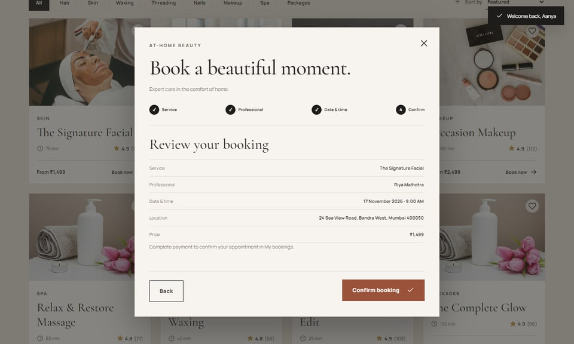
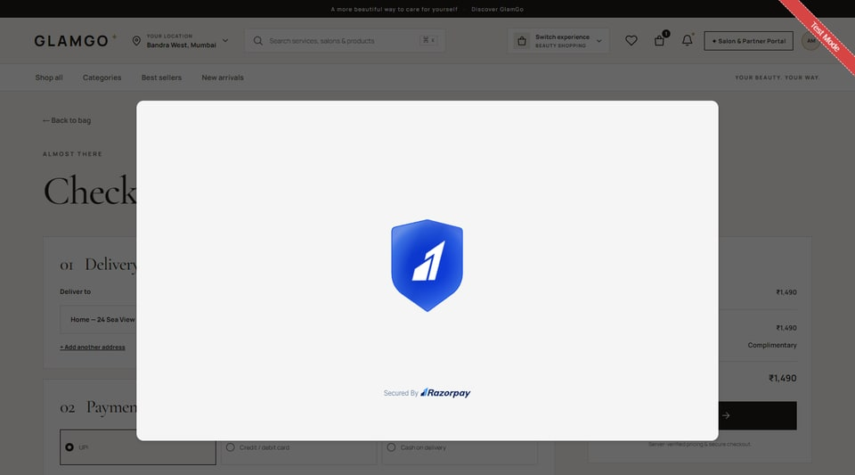
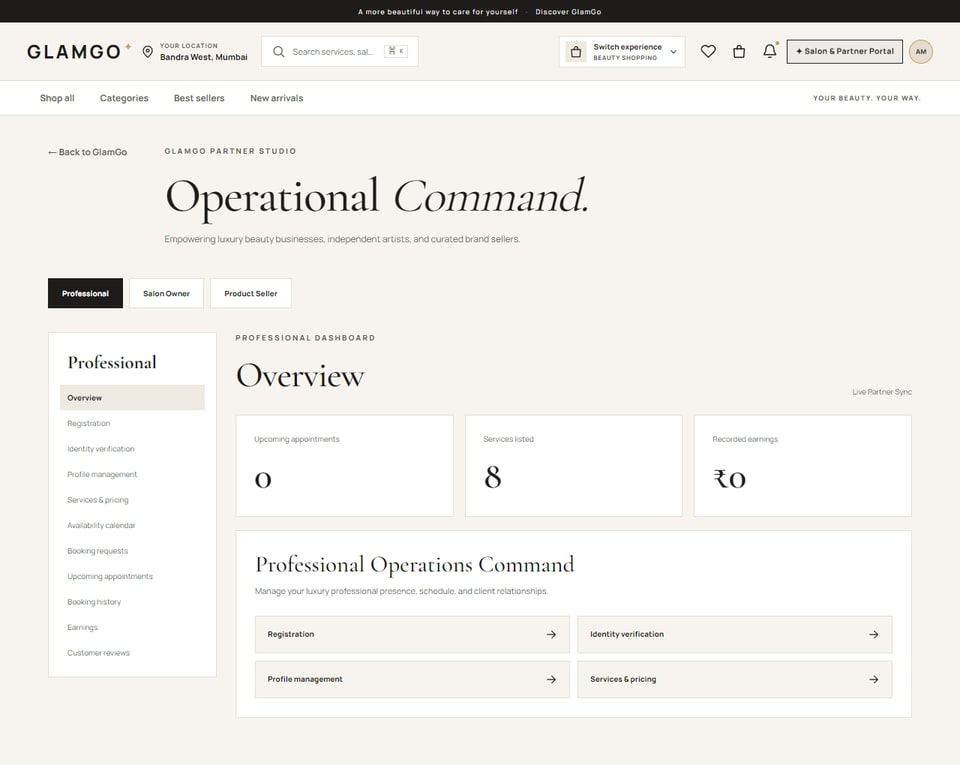
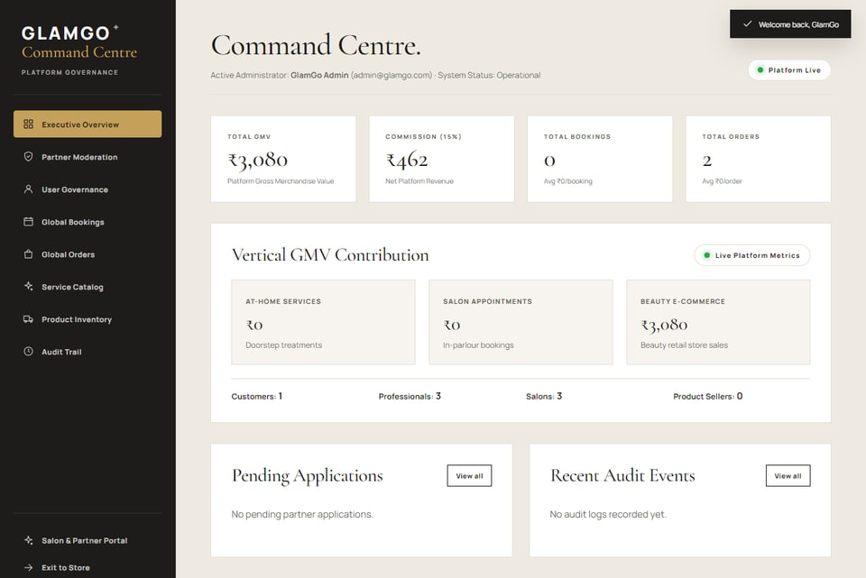
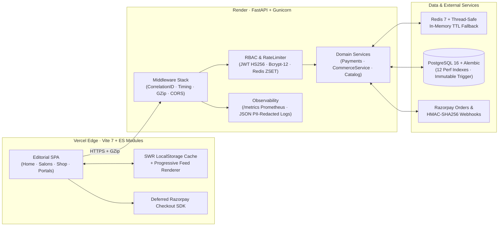
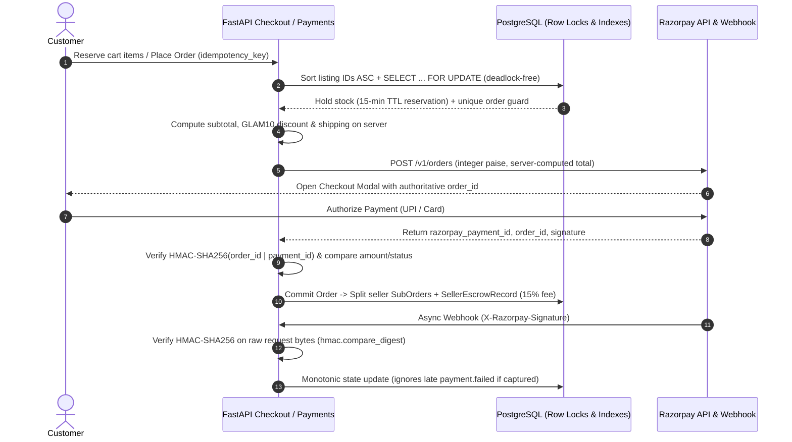

<div align="center">

<a href="https://glamgo-ricoz.vercel.app/">
  
</a>

<br />

[](https://glamgo-ricoz.vercel.app/)
[](https://glamgo-backend-lqn6.onrender.com/docs)
[](#engineering-architecture)
[](#engineering-architecture)
[](#performance-engineering--verified-benchmarks)
[](#checkout-security--multi-vendor-escrow)
[](#automated-testing--cicd)

<p>
  <strong>Beauty retail meets instant booking — engineered for zero friction.</strong><br />
  Shop curated skincare, book verified beauticians to your doorstep, and reserve local salons from one account—backed by enterprise-grade checkout security, multi-vendor escrow payouts, and sub-second return loads.
</p>

[Live Demo](https://glamgo-ricoz.vercel.app/) · [API Swagger Docs](https://glamgo-backend-lqn6.onrender.com/docs) · [Product Tour](#-live-product-walkthrough) · [Architecture](#-system-architecture) · [Performance](#-performance-engineering--verified-benchmarks) · [Local Setup](#-quick-start--local-development)

</div>

---

## ✦ In Plain English: What GlamGo Does

Most beauty apps only handle one piece of the experience—forcing customers to switch between shopping apps, home-service directories, and salon booking sites. **GlamGo unites all three inside one calm, editorial platform**, while giving independent beauty businesses everything they need to operate behind the scenes.

| Who Uses GlamGo | What They Can Do (No Jargon) |
| :--- | :--- |
| **Customers & Guests** | Browse and add products to a persistent shopping bag without signing in first; filter by category, brand, price, or bestseller; book at-home treatments in 4 guided steps; discover nearby salons; apply promo codes (`GLAM10`); pay safely via UPI/Card/COD; and track orders or request returns. |
| **At-Home Professionals** | Manage service menus, pricing, availability schedules, incoming client appointments, and recorded earnings from a dedicated operations view. |
| **Salon Owners** | Showcase salon ambiance, curate service categories and team members, track appointments, and monitor revenue. |
| **Product Sellers** | List products and size/shade variants, manage live inventory stock, process multi-vendor split shipments, and track escrow settlements and returns. |
| **Platform Admins** | Oversee platform-wide Gross Merchandise Value (GMV) and 15% commissions, approve or reject partner applications, govern user roles, and inspect tamper-proof audit trails. |

---

## 🎬 Live Product Walkthrough

*Real screenshots captured from live Vercel + Render deployments and local full-stack runs cycling through all core experiences:*

<div align="center">
  
  <br />
  <sub><b>Tour sequence:</b> Experience Switcher → At-Home Beauty → Live Salons Directory → Storefront Shelf → Product Detail Page → 4-Step Booking Modal → Razorpay Test Checkout → Partner Studio → Admin Command Centre</sub>
</div>

---

## 📸 Platform Visual Showcase

### Customer Experiences
<table>
  <tr>
    <td width="50%" align="center">
      <br />
      <strong>Three-Experience Launcher</strong><br />
      <sub>Instant guest routing across At-Home Beauty, Salons, and Shopping</sub>
    </td>
    <td width="50%" align="center">
      <br />
      <strong>The Beauty Store (Live)</strong><br />
      <sub>Dynamic collection edits, category/brand filtering, wishlist & live stock</sub>
    </td>
  </tr>
  <tr>
    <td width="50%" align="center">
      <br />
      <strong>Salon &amp; Parlour Discovery (Live)</strong><br />
      <sub>Category &amp; sort controls with real salon ratings, distance &amp; pricing</sub>
    </td>
    <td width="50%" align="center">
      <br />
      <strong>Product Detail Experience (Live)</strong><br />
      <sub>Variant/size selector, MRP savings, coupon preview &amp; tabbed details</sub>
    </td>
  </tr>
</table>

### Checkout, Booking & Operations Dashboards
<table>
  <tr>
    <td width="50%" align="center">
      <br />
      <strong>4-Step Guided Appointment Flow</strong><br />
      <sub>Service → Specialist → Date &amp; Time → Confirmation with double-book protection</sub>
    </td>
    <td width="50%" align="center">
      <br />
      <strong>Server-Verified Razorpay Checkout</strong><br />
      <sub>Authoritative paise order creation, signature check &amp; retry recovery</sub>
    </td>
  </tr>
  <tr>
    <td width="50%" align="center">
      <br />
      <strong>Salon &amp; Partner Studio</strong><br />
      <sub>Dedicated workspaces for Professionals, Salon Owners &amp; Sellers</sub>
    </td>
    <td width="50%" align="center">
      <br />
      <strong>Admin Command Centre</strong><br />
      <sub>Live GMV analytics, 15% commission ledger, moderation &amp; audit trail</sub>
    </td>
  </tr>
</table>

<details>
<summary>📱 <strong>View Live Mobile Storefront Capture (375×812 — 0px Horizontal Overflow)</strong></summary>
<br />
<div align="center">
  
</div>
</details>

---

## 🏗 System Architecture

For engineers reviewing the codebase, GlamGo separates presentation, state persistence, transaction integrity, and observability across cleanly decoupled layers:



### Tech Stack Overview

| Layer | Technology | Purpose |
| :--- | :--- | :--- |
| **Frontend** | Vite 7, Vanilla JS (ES Modules), Custom CSS | Zero-bloat component SPA (~45 kB gzipped JS), `Cormorant Garamond` + `Manrope` typography, `localStorage` SWR cache + guest bag persistence |
| **API & Business Logic** | Python 3.11+, FastAPI, Pydantic v2 | Strongly typed REST API (`/api/v1/*`), middleware telemetry, server-side pricing & commission computation |
| **Database & Migrations** | PostgreSQL 16, SQLAlchemy 2.0, Alembic | Relational integrity, row-level locking (`FOR UPDATE`), 6 Alembic revisions, custom PostgreSQL trigger & partial unique indexes |
| **Caching & Rate Limiting** | Redis 7 + Thread-Safe In-Memory Store | Sliding-window rate limiting (`ZREMRANGEBYSCORE` / `ZCARD` / `ZADD`), catalog response caching with write-path invalidation |
| **Payments** | Razorpay Python SDK & Webhooks | Server-authoritative Orders API in integer paise + raw-body `HMAC-SHA256` webhook reconciliation |
| **Testing & CI/CD** | Pytest (`62` tests), Playwright, Docker, GitHub Actions | Full API/security/concurrency regression suite, multi-viewport browser audits, automated Vercel & Render deploys |

---

## 🔒 Checkout Security & Multi-Vendor Escrow

How GlamGo guarantees **zero overselling**, **no price tampering**, and **safe payment retries**:



Key engineering safeguards implemented in [`payments.py`](backend/app/api/v1/payments.py), [`commerce_service.py`](backend/app/services/commerce_service.py), and [`04a1f8c29b10`](backend/alembic/versions/04a1f8c29b10_add_payment_reconciliation_and_idempotency.py):
- **Double-Click & Retry Protection:** Partial PostgreSQL unique indexes (`uq_orders_customer_idempotency`, `uq_bookings_customer_idempotency`) prevent duplicate records under rapid clicks or network retries, while keeping the customer's bag intact until payment is confirmed.
- **Monotonic Webhook Reconciliation:** Handles duplicate `payment.captured` / `order.paid` events idempotently and refuses out-of-order `payment.failed` mutations once a transaction has already reached `captured` or `refunded`.
- **Multi-Vendor Order Splitting & Escrow:** Groups multi-seller carts into parent `Order` + per-seller `SubOrder` records, apportions coupon discounts proportionally, logs every stock change in `InventoryAuditLog`, and manages `SellerEscrowRecord` maturity and 7-day reverse-logistics return clawbacks.

---

## ⚡ Performance Engineering & Verified Benchmarks

During live production monitoring across Vercel (India) ↔ Render (`oregon`) ↔ Neon PostgreSQL (`ap-southeast-1`), catalog views previously stalled behind N+1 ORM queries, missing cache fallbacks when `REDIS_URL` was unset, uncompressed JSON responses, and a blocking `Promise.allSettled` frontend waterfall.

<div align="center">
  
</div>

### Optimizations Implemented & Measured Live Impact
- **Removed N+1 Lazy Loads:** Added SQLAlchemy `selectinload(Salon.staff)` and `selectinload(Product.variants)` across catalog queries, backed by 12 PostgreSQL B-tree indexes ([`0395cd015fed`](backend/alembic/versions/0395cd015fed_add_production_performance_indexes.py)).
- **Dual-Mode Caching + Mutation Invalidation:** Upgraded [`CacheService`](backend/app/services/cache_service.py) with a `threading.Lock`-guarded in-memory TTL fallback whenever Redis is unconfigured, wired across all catalog endpoints and invalidated automatically upon order, partner, and admin writes.
- **Wire Compression & Browser Hints:** Enabled `GZipMiddleware(minimum_size=500)` in [`main.py`](backend/app/main.py), cutting catalog JSON wire bytes by **57.9%–64.3%**, paired with `<link rel="preconnect">` hints and `defer` on Razorpay's external script in [`index.html`](index.html).
- **SWR Progressive Rendering:** Added `localStorage` stale-while-revalidate catalog hydration + independent per-feed UI updates and concurrent session hydration in [`src/app.js`](src/app.js).

| Metric (Measured Live After Deploy `3174885`) | Before | After | Improvement |
| :--- | :--- | :--- | :--- |
| **`GET /api/v1/products/`** *(warm keep-alive)* | `2.20s` | **`0.30s`** | **~7.3x faster** · **−60.9% wire size** |
| **`GET /api/v1/salons/`** *(warm keep-alive)* | `1.37s` | **`0.27s`** | **~5.1x faster** · **−57.9% wire size** |
| **`GET /api/v1/services/`** *(warm keep-alive)* | `0.81s` | **`0.28s`** | **~2.9x faster** · **−64.3% wire size** |
| **`GET /api/v1/professionals/`** *(warm keep-alive)* | `0.82s` | **`0.26s`** | **~3.1x faster** · **−58.0% wire size** |
| **Live `#salons` Return Load (Playwright)** | Blocked on all 4 APIs | **`595ms` desktop · `346ms` mobile** | Instant cached paint + silent live sync |

> *Hosting note: The Render backend currently uses `plan: free`, so the very first cold hit after ~15 minutes of inactivity still waits once for container wake-up (~10–25s); returning browsers paint immediately from `localStorage` cache while Render wakes in the background.*

---

## 🛡 Security, Governance & Observability

- **Append-Only Admin Audit Logs:** Migration [`0194ac893adb`](backend/alembic/versions/0194ac893adb_enforce_audit_log_immutability.py) installs a PostgreSQL `BEFORE UPDATE OR DELETE` trigger (`prevent_admin_audit_log_tampering`) guaranteeing audit records cannot be altered or deleted at the database layer.
- **Fail-Open Sliding-Window Rate Limiting:** [`RateLimiter`](backend/app/core/rate_limit.py) uses Redis sorted sets (`429 Too Many Requests` + `Retry-After`) and degrades gracefully rather than breaking checkout if Redis restarts.
- **Prometheus & Structured JSON Tracing:** [`metrics.py`](backend/app/core/metrics.py) exposes HTTP latency histograms, DB pool utilization gauges, cache hit/miss counters, and commerce KPIs on `/metrics`, while [`logging_config.py`](backend/app/core/logging_config.py) attaches `X-Request-ID` `ContextVar` correlation IDs and redacts sensitive fields (`password`, `secret`, `token`, `razorpay_signature`).

---

## 🧪 Automated Testing & CI/CD

Every push and pull request targeting `master` or `main` triggers the 3-stage GitHub Actions pipeline in [`.github/workflows/production-ci.yml`](.github/workflows/production-ci.yml):
1. **Backend Test & Migration Gate:** Spins up live **PostgreSQL 16** and **Redis 7** services, runs `alembic upgrade head`, and executes **62 `pytest` tests** across 16 test files (auth, RBAC, catalog, multi-vendor reservations/escrow, tampered payments, invalid webhook signatures, cache invalidation, observability, and concurrent load targets `<250ms` health p50 at `>=35 RPS`).
2. **Frontend Production Build:** Validates `npm ci` + `npm run build` via Node 20 and Vite 7.
3. **Container Build Verification:** Builds both backend ([`backend/Dockerfile`](backend/Dockerfile)) and frontend ([`Dockerfile`](Dockerfile)) Docker images.

Verified locally & live in headless Chromium **Playwright** across desktop (`1280×768` / `1440`) and mobile (`375×812` / `320`) viewports with **`0` uncaught errors** and **`0px` horizontal overflow**.

---

## 🚀 Quick Start & Local Development

### 1. Start Infrastructure (PostgreSQL & Redis)
```bash
docker compose up -d db redis
```
- PostgreSQL runs on **`localhost:5439`** (`db: glamgo_db`, `user: glamgo`)
- Redis runs on **`localhost:6382`**

### 2. Install Backend Dependencies, Migrate & Seed
```bash
python -m venv .venv
.\.venv\Scripts\pip.exe install -r backend/requirements.txt

# Apply all Alembic migrations
.\.venv\Scripts\alembic.exe upgrade head

# Seed initial salons, services, products & role accounts
.\.venv\Scripts\python.exe -m backend.app.services.seed_service
```

### 3. Run Backend & Frontend Dev Servers
```bash
# Terminal 1 — FastAPI Backend (Swagger docs at http://127.0.0.1:8000/docs)
.\.venv\Scripts\python.exe -m uvicorn backend.app.main:app --host 127.0.0.1 --port 8000 --reload

# Terminal 2 — Vite Frontend (http://127.0.0.1:5173)
npm install
npm run dev
```

### 4. Run Automated Tests & Full Docker Stack
```bash
# Full backend regression suite (62 tests)
.\.venv\Scripts\python.exe -m pytest -v tests/

# Full containerized stack (Frontend :8080, Backend :8000, Postgres :5439, Redis :6382)
docker compose up --build -d
```

<details>
<summary>🔑 <strong>Pre-Seeded Test Accounts & Credentials (Local / Staging)</strong></summary>
<br />

| Role | Email | Password | Capabilities |
| :--- | :--- | :--- | :--- |
| **Customer** | `aanya@example.com` | `Password@123` | Services, salons, store, orders, bookings, wishlist |
| **Admin** | `admin@glamgo.com` | `Admin@123456` | Platform GMV, user governance, partner moderation, audit trail |
| **Professional** | `nisha@glamgo.com` | `Pro@123456` | Availability scheduler, booking requests, earnings |
| **Salon Owner** | `salon@glamgo.com` | `Salon@123456` | Salon profile, staff management, appointments, analytics |
| **Product Seller** | `seller@glamgo.com` | `Seller@123456` | Product listings, variants, inventory & stock, split orders |

</details>

<details>
<summary>📁 <strong>Project Structure</strong></summary>
<br />

```text
├── .github/workflows/       # 3-stage CI/CD (Postgres+Redis pytest, Vite build, Docker)
├── backend/
│   ├── alembic/versions/    # 6 migrations (schema, multi-vendor, indexes, triggers, idempotency)
│   └── app/
│       ├── api/v1/          # auth, bookings, orders, payments, partners, admin, catalog
│       ├── core/            # config, database, redis, rate_limit, metrics, logging, security
│       ├── models/          # SQLAlchemy ORM models across retail, booking & escrow ledger
│       └── services/        # commerce_service, cache_service, audit_service, seed_service
├── deploy/                  # Grafana dashboards & systemd service templates
├── docs/media/              # README SVG visuals, walkthrough GIF & real screenshots
├── src/                     # Vite SPA entrypoint, API client & component renderer
├── tests/                   # 16 Pytest suites (security, payments, concurrency, load)
├── Dockerfile & render.yaml # Container & PaaS deployment definitions
```

</details>
