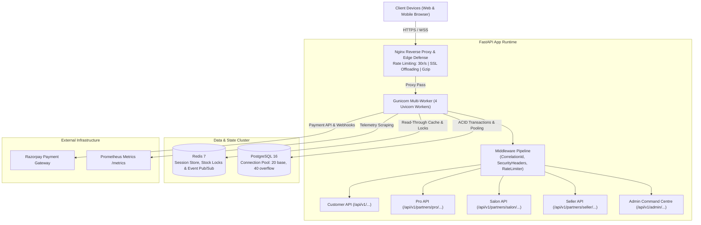
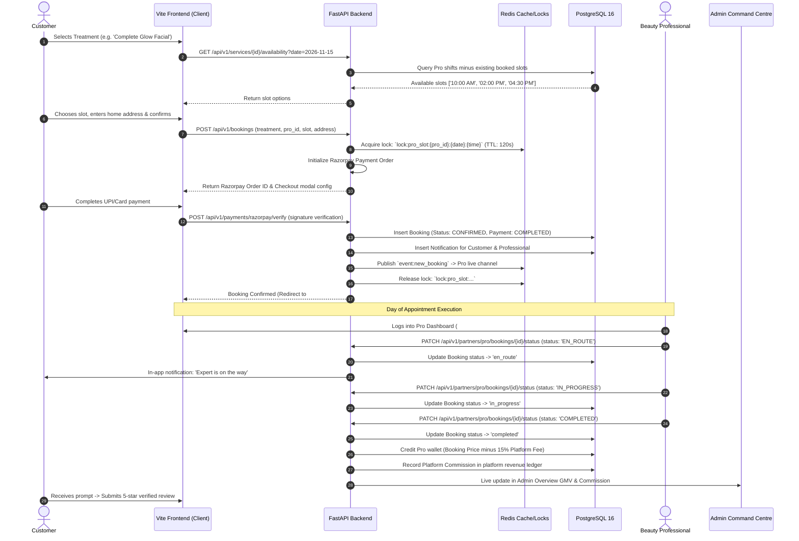
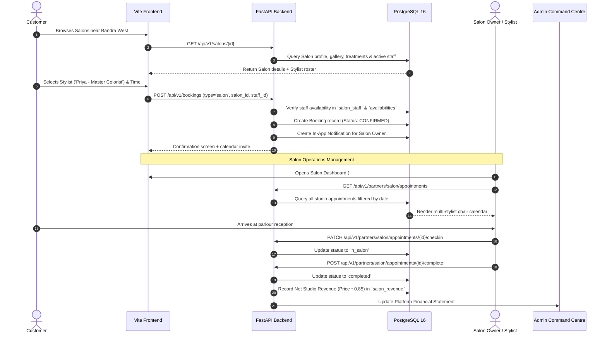
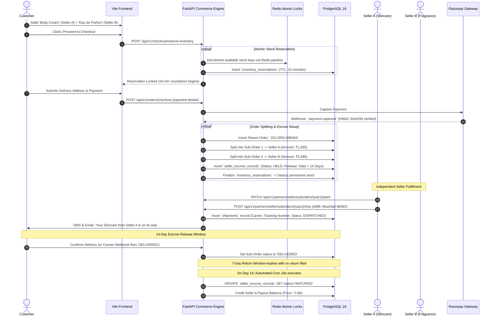
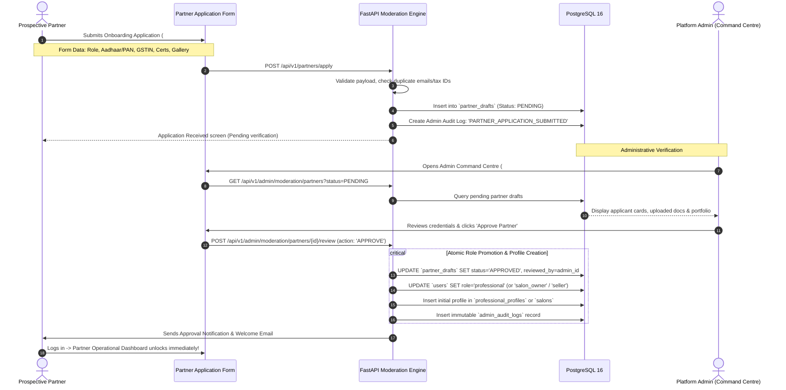

# GlamGo — End-to-End System Design & Architecture Specification

**Author:** Principal Software Architect  
**Platform:** GlamGo Luxury Beauty Marketplace  
**Tech Stack:** FastAPI, PostgreSQL 16, SQLAlchemy 2.0, Alembic, Redis 7, Vanilla JS (ES Modules), Vite 7, Nginx  

---

## Table of Contents
1. [Architecture Overview & System Topology](#1-architecture-overview--system-topology)
2. [Scenario 1: At-Home Doorstep Beauty Service Lifecycle](#2-scenario-1-at-home-doorstep-beauty-service-lifecycle)
3. [Scenario 2: Physical Salon & Studio Appointment Lifecycle](#3-scenario-2-physical-salon--studio-appointment-lifecycle)
4. [Scenario 3: Multi-Vendor E-Commerce Engine (Split Cart & Escrow)](#4-scenario-3-multi-vendor-e-commerce-engine-split-cart--escrow)
5. [Scenario 4: Partner Onboarding & KYC Governance Lifecycle](#5-scenario-4-partner-onboarding--kyc-governance-lifecycle)
6. [State Machine Reference & Data Model Dictionary](#6-state-machine-reference--data-model-dictionary)
7. [Resilience, Idempotency & Concurrency Strategy](#7-resilience-idempotency--concurrency-strategy)

---

## 1. Architecture Overview & System Topology

GlamGo unites three interconnected commercial verticals through a modular monolithic architecture with dedicated **BFF (Backend-for-Frontend)** route surfaces:



---

## 2. Scenario 1: At-Home Doorstep Beauty Service Lifecycle

This workflow handles on-demand and scheduled beauty treatments delivered directly to the client's home by verified freelance professionals.

### End-to-End Sequence Diagram



---

## 3. Scenario 2: Physical Salon & Studio Appointment Lifecycle

This workflow powers appointments at brick-and-mortar luxury salons, managing stylists, chair allocations, and studio calendars.

### End-to-End Sequence Diagram



---

## 4. Scenario 3: Multi-Vendor E-Commerce Engine (Split Cart & Escrow)

GlamGo’s multi-vendor commerce engine handles unified carts containing products from multiple independent beauty sellers, with atomic inventory reservation and automated 14-day escrow settlement.

### End-to-End Sequence Diagram



---

## 5. Scenario 4: Partner Onboarding & KYC Governance Lifecycle

Prevents unvetted or fraudulent entities from offering treatments or selling unregulated cosmetics.



---

## 6. State Machine Reference & Data Model Dictionary

### Order Lifecycle State Machine
```
[DRAFT] 
   └──> [PENDING_PAYMENT] (Inventory Reserved for 15m)
           ├── (Payment Failed / Expired) ──> [CANCELLED] (Stock Auto-Released)
           └── (Payment Captured) ──────────> [PLACED]
                                                └──> [CONFIRMED]
                                                        └──> [PACKED]
                                                                └──> [IN_TRANSIT]
                                                                        └──> [DELIVERED]
                                                                                ├── (Return Filed within 7d) ──> [RETURN_REQUESTED]
                                                                                └── (Day 14 Matured) ──────────> [SETTLED]
```

### Booking Lifecycle State Machine
```
[REQUESTED] 
   └──> [CONFIRMED] (Slot Locked)
           ├── (Cancelled by Customer/Pro) ──> [CANCELLED] (Slot Released)
           └── (Day of Service) ──────────────> [EN_ROUTE]
                                                   └──> [IN_PROGRESS]
                                                           └──> [COMPLETED] ──> [PAYOUT_RELEASED]
```

---

## 7. Resilience, Idempotency & Concurrency Strategy

1. **Sliding-Window Rate Limiter:**
   - In-memory Redis sliding-window algorithm enforcing **15 req/min on auth** and **30 req/sec platform-wide** per IP, rejecting floods with RFC 429 `Retry-After` headers.
2. **Webhook Idempotency:**
   - All payment webhooks acquire a Redis key `lock:webhook:{event_id}` for 60 seconds before processing. Replay attacks are dropped as HTTP 200 duplicate acknowledgments.
3. **Double-Booking & Overselling Prevention:**
   - Simultaneous checkouts on the same product SKU or appointment chair execute inside a PostgreSQL `SELECT ... FOR UPDATE` row-level lock combined with Redis reservation keys.
4. **Zero Data Loss Principle:**
   - Pre-deployment automated backups (`pg_dump -Fc`) run before every deployment script execution.
   - All financial and administrative mutations write to an append-only, immutable `admin_audit_logs` table.
