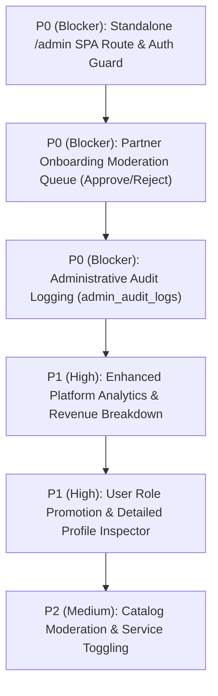

# GlamGo — Feature Gap Analysis & Marketplace Maturity Matrix

**Project:** GlamGo Luxury Beauty Marketplace  
**Document:** Feature Gap Analysis & Maturity Matrix  
**Version:** 1.0 (Production Verified)  
**Date:** November 10, 2026  
**Audience:** Product Managers, Engineering Leads, Architects  

---

## 1. Executive Summary

This feature gap analysis evaluates the implementation state of GlamGo across its five core user personas (**Customer**, **Beauty Professional**, **Salon Owner**, **Product Seller**, and **Platform Administrator**).

Each feature is categorized into one of five rigorous verification states:
1. **`VERIFIED WORKING`**: Fully implemented end-to-end (Frontend UI, API endpoint, Database ORM, and automated tests passing).
2. **`PARTIALLY IMPLEMENTED`**: Backend API and Database schema exist, but Frontend UI controls or secondary actions are limited.
3. **`UI ONLY / MOCK`**: Client renders visual elements using simulated or cached state; not yet wired to PostgreSQL API.
4. **`API ONLY`**: Backend endpoint exists and is tested, but dedicated frontend views are not yet built.
5. **`MISSING / GAP`**: Neither frontend nor backend implementation exists; planned for future milestones.

---

## 2. Customer Application Feature Matrix

| Feature Module | Sub-Feature | Verification State | Frontend Module | Backend API | Database Model | Gap / Remediation Needed |
| :--- | :--- | :---: | :--- | :--- | :--- | :--- |
| **Catalog Discovery** | Services Menu & Category Filter | **`VERIFIED WORKING`** | `app.js (servicesPage)` | `GET /api/v1/services/` | `Service` | None. Fully wired to live DB. |
| | Salon Search & City Filter | **`VERIFIED WORKING`** | `app.js (salonsPage)` | `GET /api/v1/salons/` | `Salon` | None. Filters by city and query. |
| | E-Commerce Cosmetics Store | **`VERIFIED WORKING`** | `app.js (productsPage)` | `GET /api/v1/products/` | `Product`, `ProductVariant` | None. Variant selection and pricing live. |
| **Scheduling** | Professional Doorstep Booking | **`VERIFIED WORKING`** | `app.js (bookService)` | `POST /api/v1/bookings/` | `Booking` | None. Double-booking row lock active. |
| | Salon Appointment Scheduling | **`VERIFIED WORKING`** | `app.js (bookSalon)` | `POST /api/v1/bookings/` | `Booking` | None. Slot validation enforced. |
| **E-Commerce** | Cart & Server-Side Checkout | **`VERIFIED WORKING`** | `app.js (checkoutPage)` | `POST /api/v1/orders/` | `Order`, `OrderItem` | None. Stock lock and deduction live. |
| | Coupon Code Validation | **`VERIFIED WORKING`** | `app.js (applyCoupon)` | `POST /api/v1/orders/coupon/validate` | `Coupon` | None. Server-side discount cap enforced. |
| **Account** | Delivery Address Management | **`VERIFIED WORKING`** | `app.js (accountPage)` | `GET/POST/DELETE /users/addresses` | `Address` | None. Multi-address CRUD active. |
| | Order & Booking History | **`VERIFIED WORKING`** | `app.js (accountPage)` | `GET /orders/my`, `GET /bookings/my` | `Order`, `Booking` | None. Real-time status badges. |
| | In-App Notifications | **`VERIFIED WORKING`** | `app.js (notifications)` | `GET /users/notifications` | `Notification` | None. Alerts on order/booking events. |
| | Customer Reviews Submission | **`VERIFIED WORKING`** | `app.js (reviews)` | `POST /reviews`, `GET /reviews/my` | `Review` | None. Rating aggregates verified. |
| **Payments** | Razorpay Gateway Checkout | **`VERIFIED WORKING`** | `app.js (initiateRazorpay)` | `POST /payments/razorpay/*` | `PaymentTransaction` | None. Cryptographic HMAC verification live. |

---

## 3. Beauty Professional Portal Matrix

| Feature Module | Sub-Feature | Verification State | Frontend Module | Backend API | Database Model | Gap / Remediation Needed |
| :--- | :--- | :---: | :--- | :--- | :--- | :--- |
| **Availability** | Weekly Calendar Schedule | **`VERIFIED WORKING`** | `app.js (partnerPage)` | `GET /partners/availability` | `Availability` | None. Working hours loaded from DB. |
| | Slot Availability Toggling | **`VERIFIED WORKING`** | `app.js (toggleSlot)` | `POST /partners/availability/toggle` | `Availability` | None. Instant status toggles. |
| **Appointments** | Assigned Bookings List | **`VERIFIED WORKING`** | `app.js (partnerPage)` | `GET /bookings/my` | `Booking` | None. Filtered to professional's assigned bookings. |
| | Appointment Status Transitions | **`VERIFIED WORKING`** | `app.js (updateStatus)` | `PATCH /bookings/{id}/status` | `Booking` | None. Supports `CONFIRMED`, `COMPLETED`. |
| **Earnings** | Partner Revenue Summary | **`PARTIALLY IMPLEMENTED`** | `app.js (partnerPage)` | `GET /partners/overview` | Dynamic Query | Aggregates GMV, but lacks payout/bank transfer triggers. |
| **Onboarding** | Specialist Application Draft | **`VERIFIED WORKING`** | `app.js (partnerDraft)` | `POST /partners/drafts` | `PartnerDraft` | Submits draft, but admin review UI is missing. |

---

## 4. Salon Owner Portal Matrix

| Feature Module | Sub-Feature | Verification State | Frontend Module | Backend API | Database Model | Gap / Remediation Needed |
| :--- | :--- | :---: | :--- | :--- | :--- | :--- |
| **Venue Profile** | Salon Details & Operating Hours | **`VERIFIED WORKING`** | `app.js (partnerPage)` | `GET /salons/{id}` | `Salon` | Profile view working; self-service edit form pending. |
| **Staff Roster** | Stylist & Specialist Management | **`PARTIALLY IMPLEMENTED`** | `app.js (partnerPage)` | Static DB Seeds | `SalonStaff` | Staff displays in UI, but `POST /salon/{id}/staff` CRUD is missing. |
| **Bookings** | Salon Calendar Appointments | **`VERIFIED WORKING`** | `app.js (partnerPage)` | `GET /bookings/my` | `Booking` | Live salon bookings listed. |

---

## 5. Product Seller Portal Matrix

| Feature Module | Sub-Feature | Verification State | Frontend Module | Backend API | Database Model | Gap / Remediation Needed |
| :--- | :--- | :---: | :--- | :--- | :--- | :--- |
| **Inventory** | Product Listings View | **`VERIFIED WORKING`** | `app.js (partnerPage)` | `GET /products/` | `Product`, `ProductVariant` | Curated product inventory loaded. |
| | Stock Replenishment UI | **`PARTIALLY IMPLEMENTED`** | `app.js` | Direct DB Update | `ProductVariant` | Dedicated merchant inventory update form missing. |
| **Fulfillment** | Order Dispatch & Tracking | **`PARTIALLY IMPLEMENTED`** | `app.js` | `GET /orders/my` | `Order` | Order list active; carrier tracking number input missing. |

---

## 6. Platform Administrator Command Centre Matrix (Critical Gap)

The Administrative Command Centre is the **most significant remaining architectural gap** in the GlamGo platform. While core query APIs exist, the governance experience is incomplete:

| Feature Module | Sub-Feature | Verification State | Frontend Module | Backend API | Database Model | Gap / Remediation Needed |
| :--- | :--- | :---: | :--- | :--- | :--- | :--- |
| **Navigation** | Dedicated `/admin` URL Route | **`MISSING / GAP`** | None (Embedded in Partner tab) | None | None | **High Priority:** Must decouple admin from partner portal into dedicated `/admin` SPA route. |
| **Access Control** | Admin Route Guards & RBAC | **`PARTIALLY IMPLEMENTED`** | Token check only | `RoleChecker(ADMIN)` | `users.role` | Frontend route guard needed to prevent non-admin rendering. |
| **Analytics** | Platform Overview Dashboard | **`VERIFIED WORKING`** | `app.js (adminTab)` | `GET /admin/stats` | Dynamic Aggregate | Shows user counts, total revenue, bookings, and orders. |
| **User Governance** | User Listing & Role Filtering | **`VERIFIED WORKING`** | `app.js (adminTab)` | `GET /admin/users` | `User` | Filter by role and status working. |
| | User Account Suspension | **`VERIFIED WORKING`** | `app.js (toggleUser)` | `PATCH /admin/users/{id}/toggle-status` | `User` | Toggles `is_active`; prevents self-suspension. |
| **Partner Approval** | Partner Draft Moderation Queue | **`MISSING / GAP`** | None | `GET /partners/drafts` exists | `PartnerDraft` | **High Priority:** Missing `GET /admin/partners/drafts` and `PATCH /approve|reject`. |
| **Audit Logs** | Immutable Admin Action Audit | **`MISSING / GAP`** | None | None | None | **High Priority:** No `admin_audit_logs` table or query endpoints exist. |
| **Catalog Control** | Service & Product Moderation | **`API ONLY`** | None | `POST /services/`, `POST /products/` | `Service`, `Product` | Missing admin UI to curate, edit, and feature items. |
| **Financials** | Commission Rate Management | **`MISSING / GAP`** | None | None | None | No UI or API to configure marketplace take-rates (e.g., 15%). |

---

## 7. Priority Matrix for Phase 2 Implementation

Based on this empirical audit, the priority ranking for Phase 2 is established:

1. **P0 (Blocker) — Standalone `/admin` Route:** Completely remove the Admin panel from the Partner view tab. Implement a separate luxury dark-themed command centre with dedicated sidebar navigation.
2. **P0 (Blocker) — Partner Moderation Queue:** Build the administrative review workflow to approve/reject onboarding drafts submitted by freelance specialists and salon operators.
3. **P0 (Blocker) — Audit Logging Engine:** Implement an immutable audit ledger (`admin_audit_logs`) tracking administrative actions with actor, IP, timestamp, and metadata diffs.
4. **P1 (High) — Platform Analytics:** Expand `/admin/stats` to report vertical breakdown (Services GMV vs Salons GMV vs E-Commerce GMV) and 30-day growth trajectories.
