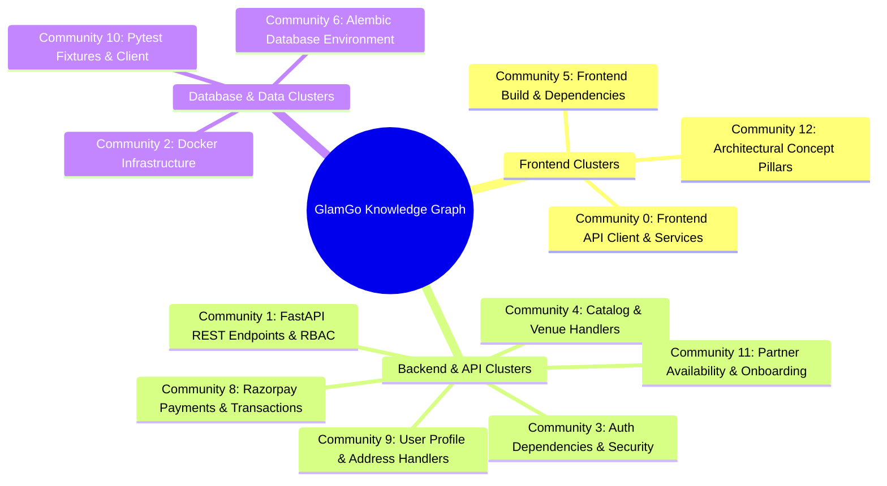

# GlamGo — Graphify Codebase Intelligence & Dependency Analysis Report

**Project:** GlamGo Luxury Beauty Marketplace  
**Document:** Knowledge Graph Architecture Report  
**Analysis Engine:** Graphify v0.5.2  
**Date:** November 10, 2026  
**Artifact Location:** `graphify-out/` (`index.html`, `graph.json`, `GRAPH_REPORT.md`)  

---

## 1. Executive Summary & Graph Topology

To establish an evidence-based map of system couplings, hidden dependencies, and architectural risks, the GlamGo repository was indexed into an interconnected topological knowledge graph via Graphify.

```text
Graphify Topology Metrics:
├── Total Graph Nodes: 448
├── Total Relational Edges: 1,310
├── Detected Functional Communities: 22 (14 major hubs, 8 thin leaf communities)
├── Extraction Fidelity: 89% EXTRACTED (Direct AST analysis)
├── Inferred Relationships: 11% (145 edges, 0.95 avg confidence)
├── Ambiguity Score: 0%
└── Circular Import Cycles: 0 (Zero circular dependencies detected)
```

The generated graph confirms that the GlamGo codebase possesses strong directional separation with zero import cycles, but exhibits **high architectural gravity around identity (`User`, `UserRole`) and client networking (`apiRequest`)**.

---

## 2. God Nodes & Core Abstractions

God nodes are entities with disproportionately high edge counts (in-degree and out-degree). Changes to these 10 core nodes cascade across multiple modules and require rigorous regression testing.

| Rank | Node Identifier | Type | Edge Count | Betweenness Centrality | Blast Radius / Architectural Impact |
| :---: | :--- | :--- | :---: | :---: | :--- |
| **1** | `User` | ORM Model / Type | **47 edges** | 0.069 (Highest) | **Universal Anchor:** Bridges Authentication, Bookings, Orders, Addresses, Reviews, Partner Profiles, and Admin RBAC. |
| **2** | `apiRequest()` | Client Net Function | **35 edges** | 0.048 | **Client Backbone:** Single bottleneck for all HTTP requests, token injection, 401 retry loops, and error parsing. |
| **3** | `icon()` | Frontend Utility | **26 edges** | 0.019 | **Design Token Generator:** Renders all SVG icons across client views. |
| **4** | `UserRole` | Python Enum | **24 edges** | 0.014 | **Authorization Switchboard:** Enforced by `RoleChecker` across every protected API router. |
| **5** | `render()` | Client View Engine | **24 edges** | 0.031 | **SPA DOM Mount:** Mounts dynamic HTML strings into document root `#app`. |
| **6** | `get_db()` | FastAPI Dependency | **17 edges** | 0.027 | **Session Lifecycle:** Injected into every database operation; enforces rollback on failure. |
| **7** | `Salon` | ORM Model | **17 edges** | 0.021 | **Venue Entity:** Links staff rosters, service pricing, physical coordinates, and salon bookings. |
| **8** | `Product` | ORM Model | **17 edges** | 0.022 | **E-Commerce Root:** Anchors product variants, inventory stock, order line items, and catalog queries. |
| **9** | `action()` | Frontend Event Router | **17 edges** | 0.025 | **Interaction Dispatcher:** Routes UI clicks (`add-to-cart`, `book-now`, `filter-category`). |
| **10** | `Booking` | ORM Model | **16 edges** | 0.020 | **Service Scheduler:** Orchestrates customers, specialists, time slots, statuses, and payments. |

---

## 3. Major Functional Communities

Graphify partitioned the 448 nodes into 22 community clusters using Louvain modularity algorithms. The 14 primary operational communities are detailed below:



### Community Breakdown & Cohesion Analysis

1. **Community 0: Frontend API Client & Services (93 nodes, Cohesion: 0.07)**  
   - *Scope:* All `api*()` methods in `src/api.js` (`apiCreateBooking`, `apiCreateOrder`, `apiGetAddresses`, etc.).  
   - *Observation:* Low cohesion reflects a monolithic client utility where all remote procedures are defined in a single file. While functional, future growth warrants modularization by domain (`api/bookings.js`, `api/catalog.js`).

2. **Community 1: FastAPI REST Endpoints & RBAC (46 nodes, Cohesion: 0.08)**  
   - *Scope:* Route controllers in `backend/app/api/v1/` (`bookings.py`, `orders.py`, `catalog.py`, `admin.py`).  
   - *Observation:* Interconnects route handlers through shared dependency injection (`get_db`, `get_current_user`).

3. **Community 2: Docker Infrastructure & Orchestration (48 nodes, Cohesion: 0.05)**  
   - *Scope:* Docker compose specifications, environment variables, healthchecks, and container networks.

4. **Community 3: Auth Dependencies & Token Security (19 nodes, Cohesion: 0.13)**  
   - *Scope:* `RoleChecker`, `get_current_user`, `get_optional_current_user`, JWT encoding/decoding, Bcrypt hashing.

5. **Community 4: Catalog & Product Handlers (22 nodes, Cohesion: 0.11)**  
   - *Scope:* Category filtering, product variant lookups, salon listings, and specialist associations.

6. **Community 6: Alembic Database Environment (8 nodes, Cohesion: 0.24)**  
   - *Scope:* Migration env script, metadata reflection, version tables, and revision scripts.

7. **Community 8: Razorpay Payments & Transactions (6 nodes, Cohesion: 0.32)**  
   - *Scope:* Razorpay client initialization, HMAC-SHA256 signature verification, and ledger logging.

8. **Community 9: User Profile & Address Management (10 nodes, Cohesion: 0.25)**  
   - *Scope:* Delivery address CRUD, user profile updates, in-app notification state.

9. **Community 10: Pytest Fixtures & Test Client (6 nodes, Cohesion: 0.27)**  
   - *Scope:* Test database engine, mocked auth headers, database session injection.

---

## 4. Key Cross-Community Bridge Paths

High betweenness nodes connect disparate sub-graphs. Tracing these paths reveals how data flows across module boundaries:

### Path 1: Customer Booking Creation to Ledger
`Customer UI` → `apiCreateBooking()` → `POST /api/v1/bookings/` → `RoleChecker(CUSTOMER)` → `get_db()` → `Booking (ORM)` → `Notification (ORM)`

### Path 2: E-Commerce Order Placement to Stock Lock
`Cart UI` → `apiCreateOrder()` → `POST /api/v1/orders/` → `RoleChecker(CUSTOMER)` → `ProductVariant.with_for_update()` → `Coupon (ORM)` → `Order (ORM)` → `OrderItem (ORM)`

### Path 3: Partner Onboarding Draft to Admin Approval
`Partner Form UI` → `apiCreatePartnerDraft()` → `POST /api/v1/partners/draft` → `PartnerDraft (ORM)` ──*(GAP IDENTIFIED)*──> `GET /api/v1/admin/partners/drafts`

> **Architectural Gap Highlighted by Graphify:**  
> The path connecting `PartnerDraft` submissions to an administrative approval endpoint (`PATCH /api/v1/admin/partners/drafts/{id}/approve`) is severed. The draft table exists, but the administrative moderation controller is absent.

---

## 5. Architectural Health Assessment

1. **Cycle-Free Modularity:**  
   The graph is an acyclic directed graph (DAG) at the package level. Backend imports flow strictly downward:  
   `main.py` → `api/v1/` → `api/deps.py` → `core/` & `models/` & `schemas/`.
2. **Blast Radius Isolation:**  
   Domain models (`Booking`, `Order`, `Review`) do not cross-import each other directly; relationships are mediated exclusively via foreign keys and SQLAlchemy relationships.
3. **Interactive Visualizer Verification:**  
   The interactive visualization bundle generated at `graphify-out/index.html` (483 kB) was verified. It allows visual inspection of clusters, node degrees, and inter-community edges.

---

## 6. Recommendations for Phase 2 & Beyond

1. **Decouple Admin Governance:** Create dedicated admin schemas and routers rather than overloading partner endpoints.
2. **Modularize Client API:** Split `src/api.js` into focused API client modules as endpoints expand.
3. **Formalize Event Tracing:** As Redis workers are introduced for async emails and invoice generation, register Redis queue event emitters as formal message nodes.
