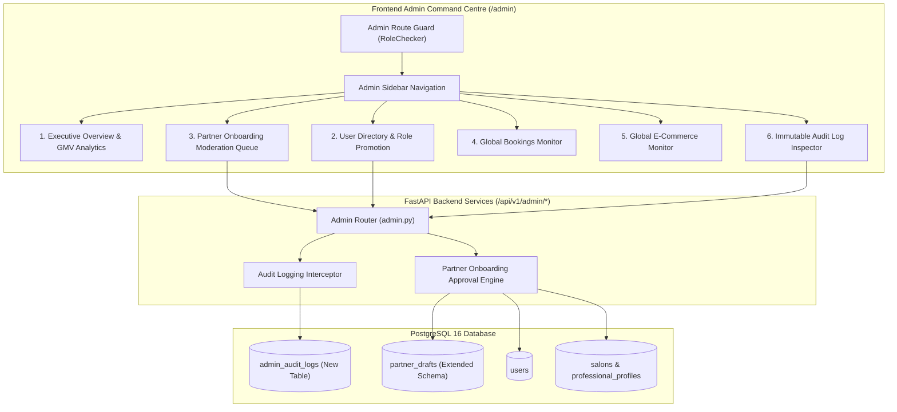

# GlamGo — Phase 2: Dedicated Administrator Command Centre & Governance System Implementation Plan

**Project:** GlamGo Luxury Beauty Marketplace  
**Document:** Phase 2 Technical Implementation Plan  
**Target Milestone:** Dedicated Admin Command Centre & Platform Governance  
**Author:** Lead Software Architect & Principal Full-Stack Engineer  
**Date:** November 10, 2026  
**Status:** Ready to Execute (Post-Phase 1 Signoff)  

---

## 1. Phase 2 Objective & Scope

The primary objective of Phase 2 is to eliminate the critical architectural gap identified during the Phase 1 audit:
**Decouple the Administrator experience from the Partner view tab into a dedicated, standalone `/admin` Single-Page Application route with complete governance, audit logging, partner draft moderation, and executive analytics.**

### Non-Negotiable Constraints
- Never compromise existing Customer or Partner application functionality.
- Retain the Vite 7 + Vanilla JS architecture with luxury `Cormorant Garamond` and `Manrope` styling.
- All administrative actions (user suspension, role changes, partner approvals) must be permanently recorded in an immutable database audit log (`admin_audit_logs`).
- Every new database change must be managed through an explicit Alembic migration.
- 100% test pass rate required before completion.

---

## 2. Architectural Blueprint



---

## 3. Database Schema Extensions & Alembic Migration

### 3.1 Migration Revision: `add_admin_audit_logs_and_moderation`
A new Alembic revision will create the `admin_audit_logs` table and add moderation state columns to `partner_drafts`:

```sql
-- 1. Create admin_audit_logs table
CREATE TABLE admin_audit_logs (
    id SERIAL PRIMARY KEY,
    admin_id INTEGER NOT NULL REFERENCES users(id) ON DELETE RESTRICT,
    action VARCHAR(100) NOT NULL,
    target_type VARCHAR(50) NOT NULL,
    target_id VARCHAR(100) NOT NULL,
    ip_address VARCHAR(45),
    details JSONB DEFAULT '{}'::jsonb,
    created_at TIMESTAMP WITH TIME ZONE DEFAULT NOW()
);
CREATE INDEX ix_audit_admin_id ON admin_audit_logs(admin_id);
CREATE INDEX ix_audit_action ON admin_audit_logs(action);
CREATE INDEX ix_audit_created_at ON admin_audit_logs(created_at DESC);

-- 2. Extend partner_drafts table
ALTER TABLE partner_drafts 
    ADD COLUMN status VARCHAR(50) NOT NULL DEFAULT 'PENDING',
    ADD COLUMN reviewed_by INTEGER REFERENCES users(id),
    ADD COLUMN reviewed_at TIMESTAMP WITH TIME ZONE,
    ADD COLUMN rejection_reason TEXT;

CREATE INDEX ix_partner_drafts_status ON partner_drafts(status);
```

---

## 4. Backend API Endpoints & Schemas

### 4.1 New & Enhanced Endpoints in `backend/app/api/v1/admin.py`

| HTTP Method | Endpoint Path | Description | Access Control |
| :---: | :--- | :--- | :---: |
| `GET` | `/api/v1/admin/stats` | Executive GMV breakdown (Services vs Salons vs E-commerce), 30-day trajectories. | `RoleChecker(ADMIN)` |
| `GET` | `/api/v1/admin/users` | Filterable user listing (by search query, role, status) with pagination. | `RoleChecker(ADMIN)` |
| `PATCH` | `/api/v1/admin/users/{id}/role` | Updates user role (e.g. `CUSTOMER` → `PROFESSIONAL`), logs audit event. | `RoleChecker(ADMIN)` |
| `PATCH` | `/api/v1/admin/users/{id}/toggle-status` | Suspends or reactivates account, logs audit event. | `RoleChecker(ADMIN)` |
| `GET` | `/api/v1/admin/partners/drafts` | Fetches pending partner onboarding submissions with draft payload. | `RoleChecker(ADMIN)` |
| `PATCH` | `/api/v1/admin/partners/drafts/{id}/approve` | Approves draft, promotes user role, provisions salon or specialist profile, logs audit event. | `RoleChecker(ADMIN)` |
| `PATCH` | `/api/v1/admin/partners/drafts/{id}/reject` | Rejects draft with formal reason, notifies applicant, logs audit event. | `RoleChecker(ADMIN)` |
| `GET` | `/api/v1/admin/audit-logs` | Retrieves paginated administrative audit logs with filtering. | `RoleChecker(ADMIN)` |

### 4.2 Audit Log Helper Dependency
```python
def log_admin_action(
    db: Session,
    admin_id: int,
    action: str,
    target_type: str,
    target_id: str,
    details: dict = None,
    ip_address: str = None
):
    audit_entry = AdminAuditLog(
        admin_id=admin_id,
        action=action,
        target_type=target_type,
        target_id=str(target_id),
        details=details or {},
        ip_address=ip_address
    )
    db.add(audit_entry)
    db.commit()
```

---

## 5. Frontend Command Centre Architecture

### 5.1 Route Decoupling & Navigation
- In `src/app.js`: Remove Admin tab from `partnerPage()`.
- Add dedicated `adminPage()` view handler mounted to navigation router: `navigate('admin')`.
- Add client-side route guard:
  ```javascript
  if (view === 'admin' && (!state.user || state.user.role !== 'admin')) {
      showToast('Administrative privileges required', 'error');
      return navigate('home');
  }
  ```

### 5.2 Command Centre Layout Structure
1. **Header Bar:** Platform name, luxury badge, active admin credentials, quick search, system health pulse.
2. **Sidebar:**
   - Overview & Analytics
   - Partner Onboarding Queue (with pending badge count)
   - User Governance
   - Global Bookings & Salon Monitor
   - Global E-Commerce Orders
   - Audit Trail
3. **Data Panes:** Responsive dark-table components with search, sort, and status pills (`PENDING`, `APPROVED`, `SUSPENDED`).
4. **Action Modals:** Review draft modal with one-click "Approve & Activate" or "Reject with Reason".

---

## 6. Implementation Waves & Sequence

```text
Phase 2 Execution Waves:
├── Wave 1: Database Migration & ORM Models (Alembic migration, AdminAuditLog model, PartnerDraft schema update)
├── Wave 2: Backend Admin Endpoints (Moderation queue, role update, audit logger helper, test suite)
├── Wave 3: Frontend API Client & State (apiGetAdminDrafts, apiApproveDraft, apiGetAuditLogs)
├── Wave 4: Frontend Admin Command Centre UI (Dedicated /admin view, sidebar, analytics, moderation table)
└── Wave 5: Automated Verification & Code Quality (Pytest regression, Playwright E2E, CodeRabbit review)
```

---

## 7. Acceptance & Exit Criteria

1. **Standalone Access:** Admin dashboard loads exclusively via `navigate('admin')` for users with `role: admin`.
2. **Zero Leaks:** Non-admin users attempting to open `/admin` or invoke admin endpoints receive `403 Forbidden`.
3. **Full Auditability:** Every status toggle, role change, and partner approval creates a permanent record in `admin_audit_logs`.
4. **Moderation Automation:** Approving a partner draft atomically updates `partner_drafts.status = 'APPROVED'` and updates the applicant's role in `users`.
5. **Testing Verification:** All existing 12 tests pass, plus a minimum of 6 new automated tests covering admin moderation and audit logging.
