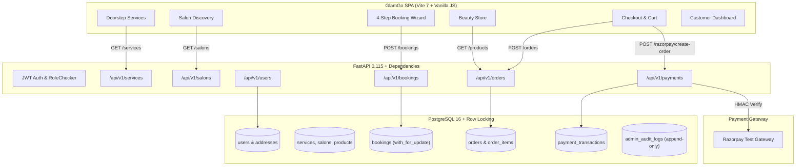
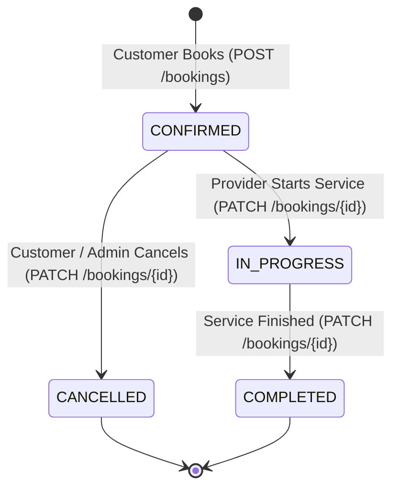

# GLAMGO — PHASE 3 ARCHITECTURE
# CUSTOMER EXPERIENCE & CORE BOOKING ENGINE

**Document Version:** 1.0.0  
**Phase:** Phase 3  
**Status:** Approved Architecture Specification  

---

## 1. ARCHITECTURAL OVERVIEW & DATA FLOW

Phase 3 establishes an end-to-end customer journey bridging discovery, real-time availability scheduling, server-side transactional booking, Razorpay payment processing, and post-purchase management.



---

## 2. CORE BOOKING ENGINE ARCHITECTURE

### 2.1 Concurrency & Double-Booking Protection
Scheduling beauty professionals requires guaranteed serializability to eliminate race conditions where two customers attempt to book the same specialist at the same time slot simultaneously.

1. **Explicit Specialist Selection:**
   - The customer requests an appointment for specialist `P` on date `D` at time `T`.
   - The query acquires a row-level lock using PostgreSQL's `with_for_update()` on existing active bookings:
     ```python
     conflict = db.query(Booking).filter(
         Booking.professional == pro_name,
         Booking.date == b_in.date,
         Booking.time == b_in.time,
         Booking.status != BookingStatus.CANCELLED
     ).with_for_update().first()
     ```
   - If a record is found, the transaction is rejected immediately with `409 Conflict`.
2. **Dynamic Specialist Dispatch ("Any available expert"):**
   - If the customer does not specify a specialist, the backend queries all verified specialists in the category, queries busy specialists for that date/time, and assigns the first available expert.
   - If all specialists are occupied, returns `409 Conflict` asking the customer to select an alternative slot.

### 2.2 Appointment Lifecycle State Machine


**RBAC State Transition Rules:**
- `CUSTOMER`: Permitted transition: `CONFIRMED -> CANCELLED` only on bookings owned by the authenticated customer. Attempting `CONFIRMED -> COMPLETED` returns `403 Forbidden`.
- `PROFESSIONAL`: Permitted transitions: `CONFIRMED -> IN_PROGRESS -> COMPLETED` only on bookings assigned to them.
- `SALON_OWNER`: Permitted transitions: `CONFIRMED -> IN_PROGRESS -> COMPLETED` only for bookings booked at their salon.
- `ADMIN`: Global override authority across all states.

---

## 3. CHECKOUT & RAZORPAY PAYMENT ARCHITECTURE

### 3.1 Financial Calculation Authority
To prevent fraudulent client-side price manipulation:
1. The frontend submits only product IDs and requested quantities: `[{"id": "b1", "qty": 2}]`.
2. The server locks the product row with `with_for_update()`, verifies that `product.is_active == True` and `product.stock >= qty`.
3. The server retrieves the database price (`product.price`) and computes:
   $$\text{subtotal} = \sum (\text{product.price} \times \text{qty})$$
4. If a coupon code is supplied, the server queries `coupons` table, verifies `is_active == True`, and calculates:
   $$\text{discount} = \min(\text{max\_discount}, \text{round}(\text{subtotal} \times \frac{\text{discount\_percent}}{100}))$$
5. Total amount:
   $$\text{total} = \max(0.0, \text{subtotal} - \text{discount})$$
6. Client-supplied amounts are ignored and overwritten.

### 3.2 Razorpay Order Creation & Signature Verification
1. **Order Initiation:**
   - Server creates a `PaymentTransaction` record linking `user_id`, `order_id` / `booking_id`, authentic server-computed `amount`, and generates an unguessable `razorpay_order_id` (format: `order_xxxxxxxx`).
2. **Client Checkout Modal:**
   - Client displays Razorpay modal populated with `key_id`, `amount`, and `razorpay_order_id`.
3. **Cryptographic Verification:**
   - Client submits the payment result: `{razorpay_order_id, razorpay_payment_id, razorpay_signature}`.
   - Server validates transaction ownership (`transaction.user_id == user.id`).
   - Server computes expected HMAC-SHA256 signature:
     $$\text{expected\_sig} = \text{HMAC-SHA256}(\text{key} = \text{RAZORPAY\_KEY\_SECRET}, \text{msg} = \text{order\_id} \parallel "|" \parallel \text{payment\_id})$$
   - Uses constant-time comparison `hmac.compare_digest()`. If valid, marks `transaction.status = "captured"` and updates order/booking `payment_status = "completed"`.

---

## 4. FRONTEND STATE ARCHITECTURE

State is centralized in `src/app.js` and persisted via `localStorage` with real-time backend synchronization:

```javascript
const state = {
  view: 'landing',          // 'landing' | 'salon-detail' | 'product-detail' | 'account' | 'cart' | 'checkout' | 'order-success' | 'booking-success' | 'tracking' | 'admin' | 'partner'
  experience: 'home',       // 'home' | 'salon' | 'shop'
  authMode: 'signin',       // 'signin' | 'signup'
  signedIn: false,
  user: null,               // { id, name, email, phone, role }
  location: 'Bandra West, Mumbai',
  addresses: [],            // List of saved addresses from /api/v1/users/addresses
  bookings: [],             // User bookings from /api/v1/bookings/my
  orders: [],               // User orders from /api/v1/orders/my
  notifications: [],        // User notifications from /api/v1/users/notifications
  reviews: [],              // User reviews from /api/v1/reviews/my
  cart: {},                 // { [productId]: quantity }
  wishlist: [],             // [serviceId | productId]
  coupon: '',               // Applied coupon code
  checkoutPayment: 'UPI',   // 'UPI' | 'Credit / debit card' | 'Cash on delivery'
  booking: {
    step: 0,
    type: 'home',
    serviceId: null,
    itemId: null,           // salon id if type == 'salon'
    professional: 'Any available expert',
    date: null,
    time: null
  },
  modal: null               // null | 'booking' | 'location' | 'date' | 'search' | 'address' | 'notifications' | 'review-add'
};
```

---

## 5. SECURITY & ACCESS CONTROL SPECIFICATIONS

1. **BOLA / IDOR Defense:**
   - Every read and write to `/bookings/{id}` and `/orders/{id}` verifies `customer_id == user.id` unless the requester is an `ADMIN`.
2. **Session Security:**
   - Standard JWT tokens expired after 60 minutes (`ACCESS_TOKEN_EXPIRE_MINUTES = 60`).
   - Refresh tokens stored securely in `localStorage` and sent over HTTPS.
3. **Audit Log Append-Only Guarantee:**
   - Enforced by PostgreSQL trigger `trg_protect_admin_audit_logs`.
