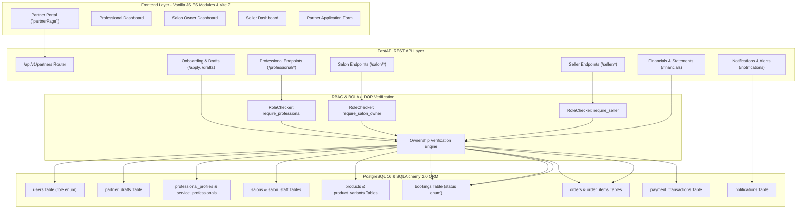
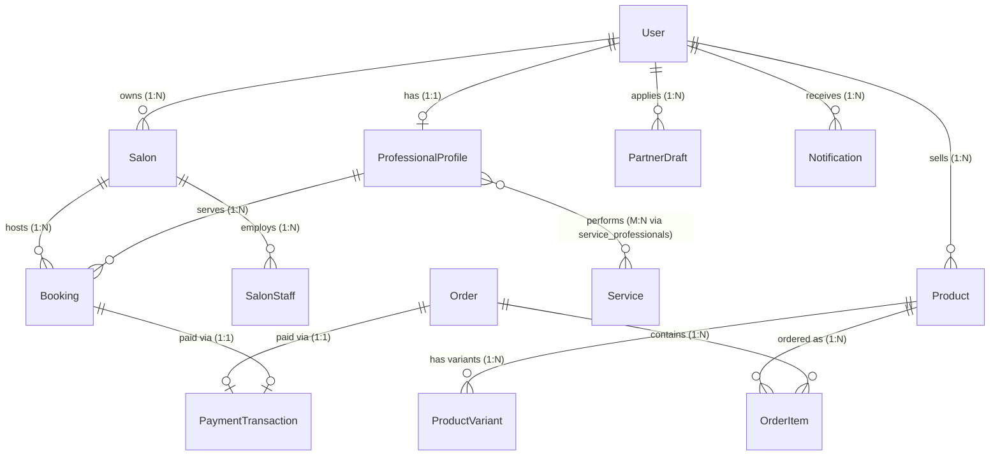
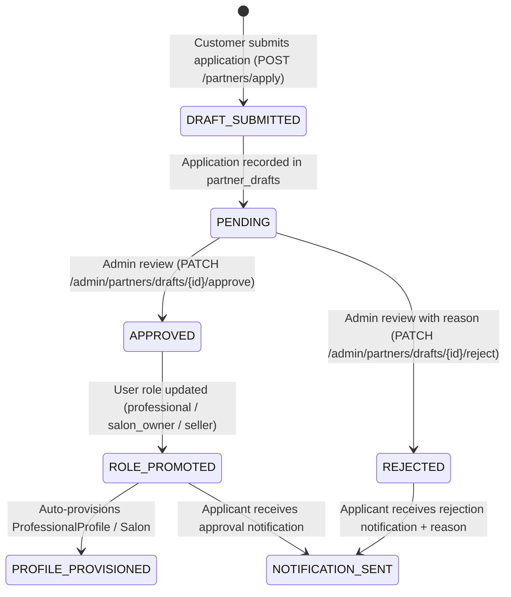
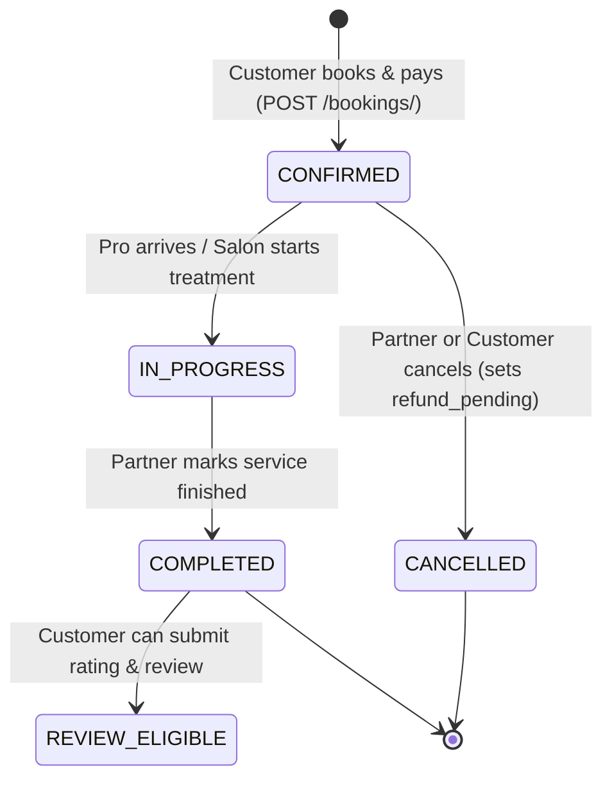
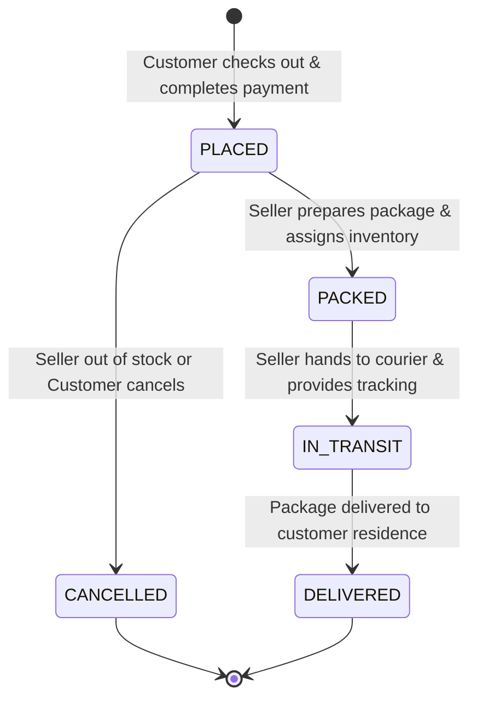

# GLAMGO — PHASE 4 ARCHITECTURE & SYSTEM DESIGN
# PARTNER ECOSYSTEM & BUSINESS OPERATIONS

**Document Version:** 1.0.0  
**Phase:** Phase 4 — Partner Ecosystem & Business Operations  
**Date:** November 11, 2026  
**Status:** Approved for Implementation  

---

## 1. ARCHITECTURAL OVERVIEW

Phase 4 expands the GlamGo platform from a customer-facing marketplace and administrative console into a comprehensive **multi-tenant partner ecosystem**. The system architecture enforces strict role separation, verifiable data ownership, and transactional financial accounting across all three partner personas:
1. **Independent Beauty Professionals** (`professional`)
2. **Salon & Parlour Owners** (`salon_owner`)
3. **Beauty Product Sellers** (`seller`)

---

## 2. DATA ENTITY RELATIONSHIPS & OWNERSHIP MATRIX

### Entity Schema & Relationships

### Data Ownership & Access Control Matrix

| Resource | Primary Owner Column | Access Guard | Read Access | Mutate Access |
| :--- | :--- | :--- | :--- | :--- |
| `PartnerDraft` | `user_id` | User ownership / `require_admin` | Owner, Admin | Owner (`create`), Admin (`approve`/`reject`) |
| `ProfessionalProfile` | `user_id` | `require_professional` | Public (catalog), Owner | Profile Owner, Admin |
| `ServiceProfessionals` | `professional_id` | `require_professional` | Public, Owner | Profile Owner, Admin |
| `Salon` | `owner_id` | `require_salon_owner` | Public (catalog), Owner | Salon Owner, Admin |
| `SalonStaff` | `salon.owner_id` | `require_salon_owner` | Public (staff details), Owner | Salon Owner, Admin |
| `Product` | `seller_id` | `require_seller` | Public (catalog), Owner | Product Seller, Admin |
| `ProductVariant` | `product.seller_id` | `require_seller` | Public, Owner | Product Seller, Admin |
| `Booking` (Home) | `professional_id` | `require_professional` | Customer, Pro, Admin | Customer (`cancel`), Pro (`status`), Admin |
| `Booking` (Salon) | `salon_id` (via `owner_id`)| `require_salon_owner` | Customer, Salon, Admin | Customer (`cancel`), Salon (`status`), Admin |
| `Order` (Fulfilment) | `items.product.seller_id` | `require_seller` | Customer, Seller, Admin | Seller (`status`), Admin |

---

## 3. OPERATIONAL STATE MACHINES

### 3.1 Partner Onboarding & Moderation Lifecycle

### 3.2 Appointment Booking Lifecycle (Partner Managed)

### 3.3 Seller Order Fulfillment Lifecycle

---

## 4. FINANCIAL OPERATIONS & COMMISSION ENGINE

All partner financial metrics are computed server-side from verified PostgreSQL transactional records. Client applications are never trusted with revenue calculations.

### Financial Equations
1. **Gross Sales ($G$):**
   - For Professionals: $\sum \text{Booking.price}$ for bookings where $\text{status} \in \{\text{CONFIRMED}, \text{COMPLETED}\}$.
   - For Salons: $\sum \text{Booking.price}$ for salon bookings where $\text{status} \in \{\text{CONFIRMED}, \text{COMPLETED}\}$.
   - For Sellers: $\sum (\text{OrderItem.price} \times \text{OrderItem.qty})$ for seller's products in orders where $\text{status} \neq \text{CANCELLED}$.

2. **Marketplace Commission ($C$):**
   $$C = G \times 15\%$$
   The platform retains a standard 15% service fee for marketing, technology infrastructure, and payment processing.

3. **Refund Deductions ($R$):**
   $$\sum \text{Transaction.amount} \quad \text{where status} \in \{\text{refund\_pending}, \text{refunded}\}$$

4. **Net Earnings ($E_{net}$):**
   $$E_{net} = G - C - R$$

5. **Settlement Ledger:**
   - **Settled Funds:** Payments already remitted through platform bank transfer or completed gateway settlement.
   - **Pending Settlement:** $E_{net} - \text{Total Settled Funds}$.
   - **Strict Rule:** Funds are never marked as "paid" or "settled" without a valid transaction reference.

---

## 5. NOTIFICATION DISPATCH ENGINE

The notification subsystem (`Notification` model in `backend/app/models/user.py`) acts as the event broker for partner operations:
- When a partner changes booking status to `completed`, a notification is created for the customer.
- When a seller updates an order to `in_transit`, a tracking alert is created for the customer.
- When an order is placed, a notification is created for each merchant whose products are in the order.
- When a product's stock count falls below 5, a high-priority low-stock notification is dispatched to the seller.
