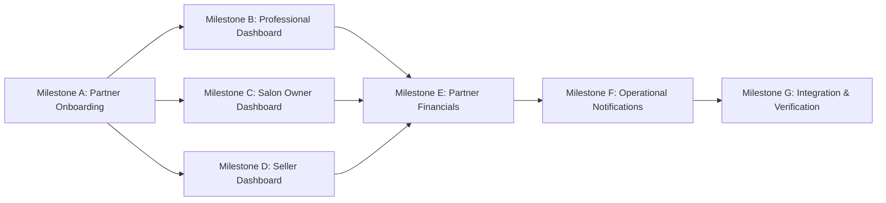

# GLAMGO — PHASE 4 PRODUCT REQUIREMENTS DOCUMENT (PRD)
# PARTNER ECOSYSTEM & BUSINESS OPERATIONS

**Document Version:** 1.0.0  
**Phase:** Phase 4 — Partner Ecosystem & Business Operations  
**Date:** November 11, 2026  
**Status:** Approved for Implementation  
**Target Personas:** Independent Professionals, Salon Owners, Product Sellers, Platform Administrators  

---

## 1. EXECUTIVE SUMMARY & OBJECTIVES

GlamGo is an ultra-luxury beauty marketplace operating across three primary verticals:
1. **At-Home Beauty Services:** Certified independent beauty artists delivering bespoke treatments to client residences.
2. **Salon & Parlour Discovery:** Premium salons, spas, and parlours offering in-studio appointments with designated staff.
3. **Luxury Beauty E-Commerce:** Brand merchants and boutique sellers delivering high-end skincare, cosmetics, and wellness products.

While Phases 1 through 3 established the core baseline, administrative command centre, security hardening, and customer booking engine, **Phase 4 builds the complete operational ecosystem for GlamGo's supply side**.

### Core Business Objectives
- **Frictionless Onboarding with Strict Governance:** Enable potential partners to submit structured applications with credentials and portfolio links while maintaining administrative moderation and strict role escalation controls.
- **Dedicated Persona Dashboards:** Deliver tailored operational interfaces for Independent Professionals, Salon Owners, and Product Sellers.
- **Operational Autonomy:** Allow partners to manage catalogs, schedules, staff, inventory, appointments, and order fulfillment in real time.
- **Financial Transparency & Accuracy:** Provide comprehensive gross earnings, 15% marketplace commission breakdown, refund deductions, and real settlement tracking without fabricating payouts.
- **Security & Integrity:** Prevent Broken Object-Level Authorization (BOLA/IDOR), ensure concurrent inventory consistency, and protect customer and partner privacy.

---

## 2. PERSONA DEFINITIONS

| Persona | Role Key (`UserRole`) | Primary Responsibilities | Core Workflows |
| :--- | :--- | :--- | :--- |
| **Independent Professional** | `professional` | Delivers in-home beauty services | Profile management, service pricing, weekly availability, booking accept/complete/cancel, net earnings review. |
| **Salon Owner** | `salon_owner` | Operates beauty studios & manages staff | Studio profile & gallery, operating hours, staff roster & specialties, appointment calendar management. |
| **Product Seller** | `seller` | Fulfils physical beauty products | Catalog listing, variant management, stock tracking, order fulfillment (`packed` → `in_transit` → `delivered`). |
| **Platform Administrator** | `admin` | Governs the marketplace | Application moderation (approve/reject), commission configuration, audit log inspection, dispute oversight. |

---

## 3. IMPLEMENTATION MILESTONES & STORIES

### Milestone A: Partner Onboarding & Governance
- **`PART-001` (P0): Multi-Persona Partner Application & Credential Submission**
  - **User Story:** As an aspiring partner (professional, salon owner, or merchant), I want to submit a detailed application including business details, pricing/revenue expectations, and credential/portfolio links so that GlamGo can review my application.
  - **Acceptance Criteria:**
    - Dedicated endpoint `POST /api/v1/partners/apply` supporting roles: `professional`, `salon_owner`, `seller`.
    - Server validates non-empty name, email, phone, city, description/bio, base price/revenue, and portfolio/document references.
    - Application records state `PENDING` in `partner_drafts`.
    - Does NOT alter the user's role until explicit admin approval (prevents unauthorized self-promotion).
- **`PART-002` (P0): Duplicate Application Prevention & Admin Moderation Integration**
  - **User Story:** As a platform administrator, I want to review incoming partner applications in the moderation queue and approve or reject them with documented audit logs.
  - **Acceptance Criteria:**
    - Submitting a duplicate application when one is already `PENDING` returns `HTTP 409 Conflict`.
    - Users who already hold the target partner role cannot re-apply for the same role.
    - Admin approval promotes `user.role` to target role and auto-provisions `ProfessionalProfile` or `Salon` if non-existent.
    - Admin rejection requires a mandatory reason, records reviewer ID, and dispatches an in-app notification to the applicant.

### Milestone B: Professional Dashboard
- **`PART-003` (P0): Professional Profile, Portfolio & Bio Management**
  - **User Story:** As a certified professional, I want to manage my public profile, experience, specialty, and portfolio images so clients see my verified expertise.
  - **Acceptance Criteria:**
    - `GET /api/v1/partners/professional/profile` retrieves authenticated professional's profile.
    - `PUT /api/v1/partners/professional/profile` updates specialty, experience, base price, image URL, and bio with strict ownership check.
- **`PART-004` (P0): Professional Service Offerings & Pricing Mapping**
  - **User Story:** As an independent professional, I want to customize the services I offer and their duration/pricing so clients can book treatments matching my catalog.
  - **Acceptance Criteria:**
    - `GET /api/v1/partners/professional/services` returns services assigned to the professional.
    - `POST /api/v1/partners/professional/services` associates an active service from the master catalog with the professional.
    - `DELETE /api/v1/partners/professional/services/{service_id}` disassociates a service without deleting it globally.
- **`PART-005` (P0): Availability Calendar & Appointment Lifecycle**
  - **User Story:** As a professional, I want to configure my available workdays and manage incoming appointment requests (accept, complete, or cancel).
  - **Acceptance Criteria:**
    - `GET /api/v1/partners/availability` and `POST /api/v1/partners/availability/toggle` allow toggling days (Mon–Sun).
    - `GET /api/v1/partners/professional/bookings` returns all appointments where `professional_id == current_pro.id`.
    - `PATCH /api/v1/partners/professional/bookings/{id}/status` allows transitioning status between `confirmed`, `completed`, and `cancelled`.
    - BOLA/IDOR protection: Attempting to update another professional's booking returns `HTTP 403 Forbidden`.

### Milestone C: Salon Owner Dashboard
- **`PART-006` (P0): Salon Profile, Operating Hours & Gallery Management**
  - **User Story:** As a salon owner, I want to manage my salon's profile, description, address, operating hours, and gallery photos.
  - **Acceptance Criteria:**
    - `GET /api/v1/partners/salon/profile` retrieves the salon where `owner_id == current_user.id`.
    - `PUT /api/v1/partners/salon/profile` updates salon name, area, hours, about, price, and image.
- **`PART-007` (P0): Salon Staff Roster & Specialty Management**
  - **User Story:** As a salon owner, I want to add, view, and remove stylists and therapists on my salon's staff roster.
  - **Acceptance Criteria:**
    - `GET /api/v1/partners/salon/staff` returns all staff members linked to the owner's salon.
    - `POST /api/v1/partners/salon/staff` adds a new staff member with name, specialty, and optional avatar.
    - `DELETE /api/v1/partners/salon/staff/{staff_id}` removes the staff member from the salon.
    - Strict salon ownership check on all staff mutations.
- **`PART-008` (P0): Salon Appointment Calendar & Status Management**
  - **User Story:** As a salon owner, I want to view upcoming client appointments scheduled at my studio and update their status.
  - **Acceptance Criteria:**
    - `GET /api/v1/partners/salon/bookings` returns all bookings where `salon_id == owner_salon.id`.
    - `PATCH /api/v1/partners/salon/bookings/{id}/status` allows marking appointments as `completed` or `cancelled`.

### Milestone D: Seller Dashboard
- **`PART-009` (P0): Seller Product Catalog, Variants & Pricing Management**
  - **User Story:** As a beauty merchant, I want to list and edit my cosmetic products, add size/shade variants, and manage pricing.
  - **Acceptance Criteria:**
    - `GET /api/v1/partners/seller/products` returns products where `seller_id == current_user.id`.
    - `POST /api/v1/partners/seller/products` creates a new product associated with the seller.
    - `PUT /api/v1/partners/seller/products/{id}` edits product details with strict ownership verification.
    - `POST /api/v1/partners/seller/products/{id}/variants` adds product variants (e.g., "50ml", "Shade 02").
- **`PART-010` (P0): Real-Time Inventory Stock Tracking & Low-Stock Alerts**
  - **User Story:** As a seller, I want to update product stock quantities and receive alerts when inventory drops below threshold.
  - **Acceptance Criteria:**
    - `PATCH /api/v1/partners/seller/products/{id}/stock` updates stock count.
    - When product stock drops to `<= 5`, the system generates an in-app low-stock notification to the seller.
- **`PART-011` (P0): Seller Order Fulfillment Workflow & Returns Visibility**
  - **User Story:** As a seller, I want to view incoming orders containing my products, advance order statuses through fulfillment, and view returns.
  - **Acceptance Criteria:**
    - `GET /api/v1/partners/seller/orders` returns orders containing the seller's products.
    - `PATCH /api/v1/partners/seller/orders/{id}/status` advances order status through valid transitions (`placed` → `packed` → `in_transit` → `delivered`, or `cancelled`).
    - Customer receives in-app notifications on each fulfillment stage transition.

### Milestone E: Partner Financial Operations
- **`PART-012` (P0): Partner Financial Statements, 15% Platform Commission & Settlements**
  - **User Story:** As a partner, I want to view my gross earnings, platform commission deductions (15%), refund adjustments, and net payout statements with date filtering.
  - **Acceptance Criteria:**
    - `GET /api/v1/partners/financials` computes:
      - Gross Sales = sum of prices of completed/confirmed bookings or sold order items.
      - Platform Commission = 15% of gross sales.
      - Refund Deductions = gross amount of cancelled/refunded transactions.
      - Net Earnings = Gross Sales - Platform Commission - Refund Deductions.
      - Settlement Breakdown = records of pending and completed settlements with dates and reference IDs.
    - Supports optional `start_date` and `end_date` filtering.
    - Strict financial rule: Settlements are only displayed as `completed` if a real payment transaction exists; never fabricates fictitious payouts.

### Milestone F: Operational Notifications
- **`PART-013` (P1): Operational Notifications & Dispatch Center**
  - **User Story:** As a partner or customer, I want to receive real-time notifications for critical operational events.
  - **Acceptance Criteria:**
    - Events triggering notifications:
      - Application approved / rejected (to applicant).
      - New booking created (to professional or salon owner).
      - Booking status updated (to customer and partner).
      - Order status updated (to customer and seller).
      - Product low stock (to seller).
    - Read state management via `GET /api/v1/notifications/` and `POST /api/v1/notifications/{id}/read`.

### Milestone G: Integration & Verification
- **`PART-014` (P0): End-to-End Partner Regression Harness & Production Verification**
  - **User Story:** As lead architect, I want an end-to-end regression test suite verifying all partner personas, security boundaries, and production build health.
  - **Acceptance Criteria:**
    - Automated tests in `tests/test_partner_phase4.py` covering all 14 stories.
    - BOLA/IDOR protection verified across all partner mutations.
    - Full regression test suite passing with 100% pass rate.
    - Frontend production build succeeds via Vite 7.

---

## 4. NON-FUNCTIONAL REQUIREMENTS

1. **Security & Authorization:**
   - RBAC enforced using `require_professional`, `require_salon_owner`, `require_seller`, `require_partner`, and `require_admin`.
   - Strict data isolation: No partner can view or mutate records belonging to another partner.
2. **Database Integrity & Concurrency:**
   - Transactions managed via SQLAlchemy 2.0 sessions with explicit commits/rollbacks.
   - Preserves all existing tables and records with zero destructive alterations.
3. **UX & Design System:**
   - Adheres to the GlamGo luxury editorial aesthetic (`Cormorant Garamond`, `Manrope`, Obsidian, Warm Ivory, Champagne).
   - Dedicated persona tabs within the partner portal for streamlined navigation.
