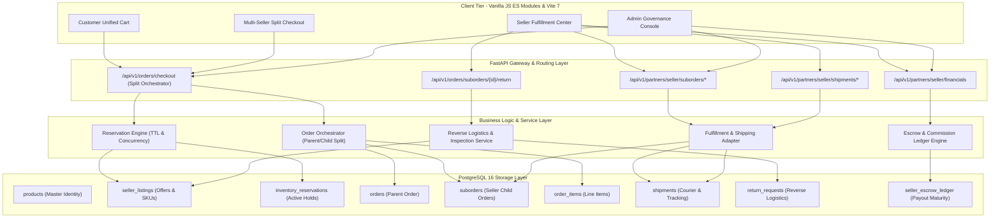
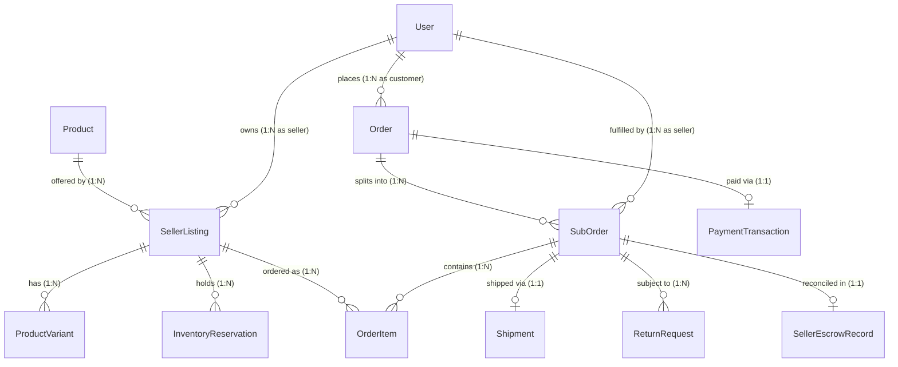
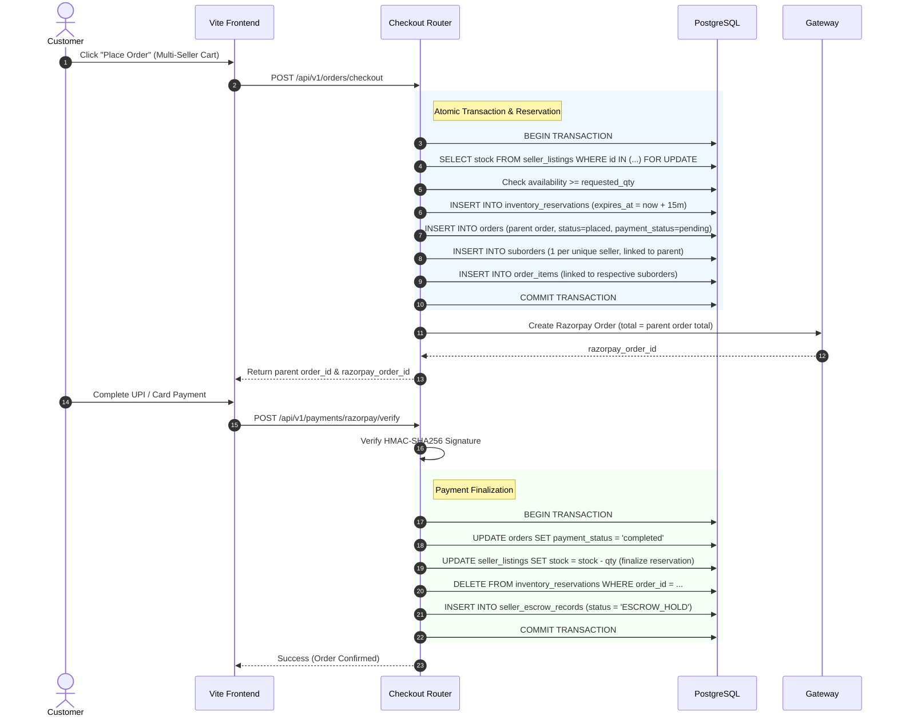
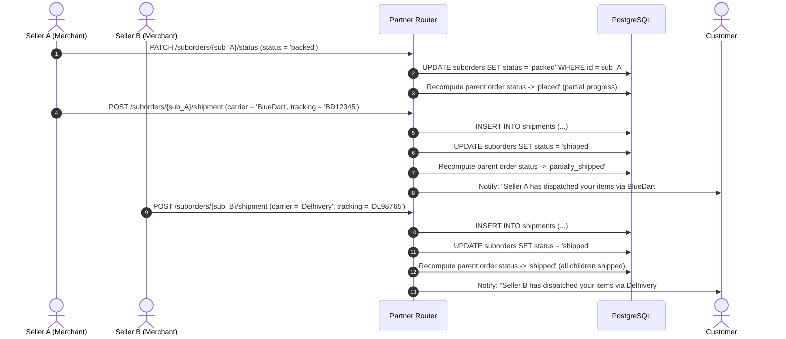
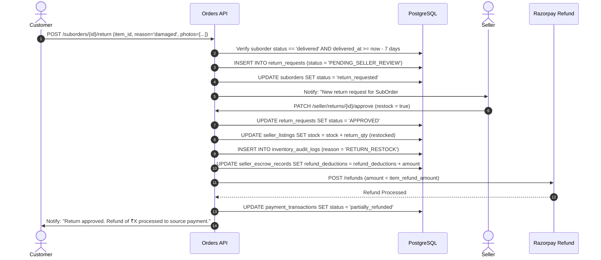
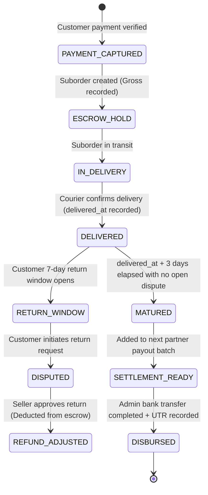

# GLAMGO — PHASE 5 ARCHITECTURE & SYSTEM DESIGN
# MULTI-VENDOR COMMERCE & FULFILLMENT ENGINE

**Document Version:** 1.0.0 (Pre-Implementation Canonical Architecture)  
**Phase:** Phase 5 — Multi-Vendor Commerce & Fulfillment Engine  
**Date:** November 11, 2026  
**Status:** In Review (Planning Phase)  

---

## 1. HIGH-LEVEL SYSTEM ARCHITECTURE

The GlamGo Multi-Vendor Commerce Engine evolves the single-seller model into a decoupled, distributed commerce architecture. The engine manages the relationship between canonical master products and multiple competitive seller offerings, handles atomic inventory reservations, orchestrates split parent/child orders, coordinates independent courier shipments, and enforces financial escrow maturity.



---

## 2. DATA ENTITY RELATIONSHIPS & DECOMPOSITION

### Entity Relationship Model



### Entity Responsibilities

1. **`Product` (Master Catalog Identity):**
   - Stores canonical brand, product title, category, global description, ingredients, primary image gallery, and customer rating.
   - Decoupled from seller identity; acts as the single source of truth for beauty consumers.
2. **`SellerListing` (Seller Offer):**
   - Links a seller (`users.id`) to a `Product`.
   - Stores seller-specific SKU, pricing (`price`, compare-at `old_price`), stock quantity, fulfillment origin city, and active status.
3. **`InventoryReservation` (Concurrency Lock):**
   - Created at checkout session start; locks $Q$ units of a `SellerListing` with `expires_at = now() + 15m`.
   - Automatically released upon expiry if checkout is abandoned or payment fails.
4. **`Order` (Parent Customer Order):**
   - Represents the customer-facing basket transaction (`GG-XXXXX`).
   - Stores overall total, customer reference, payment status, aggregated fulfillment status, and delivery address.
5. **`SubOrder` (Seller Order Slice):**
   - Child order uniquely assigned to one seller (`SUB-XXXXX-SELLERID`).
   - Owns subtotal, seller shipping fee, allocated discount, and independent fulfillment lifecycle (`placed`, `packed`, `shipped`, `delivered`, `cancelled`).
6. **`Shipment` (Courier & Dispatch):**
   - Stores courier name, tracking number, dispatch date, estimated delivery, and delivery timestamp.
7. **`ReturnRequest` (Reverse Logistics):**
   - Tracks customer return requests, return reasons, condition descriptions, seller approval/rejection, and restocking flags.
8. **`SellerEscrowRecord` (Settlement Ledger):**
   - Tracks suborder gross, 15% marketplace commission, shipping reimbursement, refund deductions, and payout maturity status (`ESCROW_HOLD` vs `MATURED_FOR_PAYOUT`).

---

## 3. SEQUENCE DIAGRAMS & DATA FLOWS

### 3.1 Multi-Vendor Checkout & Split Order Creation



---

### 3.2 Independent Seller Fulfillment & Tracking Lifecycle



---

### 3.3 Reverse Logistics & Item Return Workflow



---

## 4. CONCURRENCY & RACE-CONDITION DEFENSE

### 4.1 Row-Locking Reservation Strategy
To eliminate inventory race conditions during high-demand drops (e.g. flash sales on luxury cosmetics):
1. The checkout service initiates a transaction and executes:
   ```sql
   SELECT id, stock FROM seller_listings 
   WHERE id = :listing_id 
   FOR UPDATE;
   ```
2. The available stock is evaluated:
   $$\text{Available Stock} = \text{Current Stock} - \sum \text{Unexpired Active Reservations}$$
3. If $\text{Available Stock} \ge \text{Requested Qty}$, an `InventoryReservation` is created with a 15-minute expiration timestamp.
4. If unavailable, an `HTTP 409 Conflict` is returned immediately with the exact remaining available count.

### 4.2 Background Reservation Cleanup Sweeper
A scheduled background task runs periodically to release stale reservations:
```sql
DELETE FROM inventory_reservations 
WHERE expires_at < NOW() AND status = 'HELD';
```
This guarantees that abandoned checkout sessions automatically return reserved inventory to the public marketplace without manual administrative intervention.

---

## 5. ESCROW MATURITY & SETTLEMENT PIPELINE

GlamGo enforces a $T+3$ day escrow holding policy to safeguard marketplace trust and financial solvency:



---

## 6. SECURITY & BOLA/IDOR ACCESS MATRIX

| Resource Endpoint | Access Filter | Role Guard | Error on Violation |
| :--- | :--- | :--- | :--- |
| `GET /partners/seller/suborders` | `suborder.seller_id == user.id` | `require_seller` | Only returns owned suborders |
| `PATCH /partners/seller/suborders/{id}/*` | `suborder.seller_id == user.id` | `require_seller` | `403 Forbidden` |
| `POST /partners/seller/shipments` | `shipment.suborder.seller_id == user.id` | `require_seller` | `403 Forbidden` |
| `PATCH /partners/seller/returns/{id}/*` | `return_request.suborder.seller_id == user.id`| `require_seller` | `403 Forbidden` |
| `GET /orders/{parent_id}` | `order.customer_id == user.id` | `get_current_user` | `403 Forbidden` |
| `POST /orders/suborders/{id}/return` | `suborder.order.customer_id == user.id` | `get_current_user` | `403 Forbidden` |
