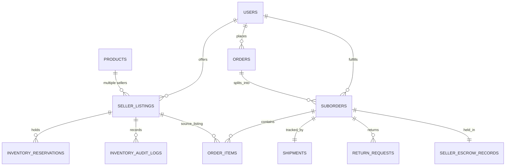

# GLAMGO — PHASE 5 DATABASE DESIGN SPECIFICATION
# MULTI-VENDOR COMMERCE & FULFILLMENT ENGINE

**Document Version:** 1.0.0 (Pre-Implementation Canonical Design)  
**Phase:** Phase 5 — Multi-Vendor Commerce & Fulfillment Engine  
**Date:** November 11, 2026  
**Status:** In Review (Planning Phase — No Database Modifications Applied)  
**Target Engine:** PostgreSQL 16 / SQLAlchemy 2.0 / Alembic  

---

## 1. DESIGN OBJECTIVES & INTEGRITY PRINCIPLES

1. **Zero Data Loss & Backward Compatibility:** Existing tables (`products`, `orders`, `order_items`, `payment_transactions`, `users`) must remain fully functional. Historical orders from Phases 1–4 without suborders must remain readable without foreign-key corruption.
2. **Catalog Decoupling (Master vs. Listing):** Master catalog identity (`products`) defines shared brand, category, imagery, and description. `seller_listings` defines seller-specific offer price, stock, SKU, and shipping policies.
3. **Multi-Vendor Order Hierarchy:** Decouple monolithic orders into `orders` (parent transaction) and `suborders` (child package per seller).
4. **Two-Phase Inventory Commit:** `inventory_reservations` records stock holds with a 15-minute TTL. Stock is deducted only upon verified payment.
5. **Auditable Stock Movements:** `inventory_audit_logs` maintains an immutable append-only trail for every stock change.
6. **Escrow Maturity Ledger:** `seller_escrow_records` locks partner earnings until the $T+3$ day post-delivery return window closes.

---

## 2. ENTITY RELATIONSHIP MODEL



---

## 3. TABLE SPECIFICATIONS & DDL

### 3.1 `seller_listings`
Decouples seller inventory and pricing from master `products`.

```sql
CREATE TABLE seller_listings (
    id SERIAL PRIMARY KEY,
    product_id VARCHAR(50) NOT NULL REFERENCES products(id) ON DELETE CASCADE,
    seller_id INTEGER NOT NULL REFERENCES users(id) ON DELETE CASCADE,
    sku VARCHAR(100) NOT NULL,
    price DOUBLE PRECISION NOT NULL,
    compare_at_price DOUBLE PRECISION DEFAULT 0.0,
    stock INTEGER NOT NULL DEFAULT 0,
    is_active BOOLEAN NOT NULL DEFAULT TRUE,
    condition VARCHAR(50) NOT NULL DEFAULT 'NEW',
    shipping_lead_time_days INTEGER NOT NULL DEFAULT 2,
    created_at TIMESTAMP WITH TIME ZONE DEFAULT CURRENT_TIMESTAMP,
    updated_at TIMESTAMP WITH TIME ZONE DEFAULT CURRENT_TIMESTAMP,
    
    CONSTRAINT uq_seller_product UNIQUE (product_id, seller_id),
    CONSTRAINT uq_seller_sku UNIQUE (seller_id, sku),
    CONSTRAINT ck_listing_price CHECK (price > 0),
    CONSTRAINT ck_listing_stock CHECK (stock >= 0)
);

CREATE INDEX ix_seller_listings_product ON seller_listings(product_id);
CREATE INDEX ix_seller_listings_seller ON seller_listings(seller_id);
CREATE INDEX ix_seller_listings_active_price ON seller_listings(product_id, is_active, price);
```

### 3.2 `inventory_reservations`
Manages 15-minute TTL stock holds during checkout.

```sql
CREATE TYPE reservation_status_enum AS ENUM ('PENDING', 'CONFIRMED', 'RELEASED', 'EXPIRED');

CREATE TABLE inventory_reservations (
    id SERIAL PRIMARY KEY,
    reservation_token VARCHAR(64) NOT NULL,
    listing_id INTEGER NOT NULL REFERENCES seller_listings(id) ON DELETE CASCADE,
    user_id INTEGER NOT NULL REFERENCES users(id) ON DELETE CASCADE,
    qty INTEGER NOT NULL DEFAULT 1,
    status reservation_status_enum NOT NULL DEFAULT 'PENDING',
    expires_at TIMESTAMP WITH TIME ZONE NOT NULL,
    created_at TIMESTAMP WITH TIME ZONE DEFAULT CURRENT_TIMESTAMP,

    CONSTRAINT ck_reservation_qty CHECK (qty > 0)
);

CREATE INDEX ix_inv_res_token ON inventory_reservations(reservation_token);
CREATE INDEX ix_inv_res_status_expires ON inventory_reservations(status, expires_at);
CREATE INDEX ix_inv_res_listing_status ON inventory_reservations(listing_id, status);
```

### 3.3 `suborders`
Decouples parent orders into autonomous seller-level fulfillable packages.

```sql
CREATE TYPE suborder_status_enum AS ENUM (
    'placed',
    'packed',
    'in_transit',
    'delivered',
    'cancelled',
    'return_requested',
    'returned'
);

CREATE TABLE suborders (
    id VARCHAR(60) PRIMARY KEY, -- e.g. GG1234567-S1
    parent_order_id VARCHAR(50) NOT NULL REFERENCES orders(id) ON DELETE CASCADE,
    seller_id INTEGER NOT NULL REFERENCES users(id) ON DELETE RESTRICT,
    subtotal DOUBLE PRECISION NOT NULL,
    shipping_fee DOUBLE PRECISION NOT NULL DEFAULT 0.0,
    discount DOUBLE PRECISION NOT NULL DEFAULT 0.0,
    total DOUBLE PRECISION NOT NULL,
    commission_rate DOUBLE PRECISION NOT NULL DEFAULT 0.15,
    commission_amount DOUBLE PRECISION NOT NULL,
    seller_payout DOUBLE PRECISION NOT NULL,
    status suborder_status_enum NOT NULL DEFAULT 'placed',
    cancellation_reason TEXT,
    created_at TIMESTAMP WITH TIME ZONE DEFAULT CURRENT_TIMESTAMP,
    updated_at TIMESTAMP WITH TIME ZONE DEFAULT CURRENT_TIMESTAMP
);

CREATE INDEX ix_suborders_parent ON suborders(parent_order_id);
CREATE INDEX ix_suborders_seller_status ON suborders(seller_id, status);
CREATE INDEX ix_suborders_created_at ON suborders(created_at DESC);
```

### 3.4 Modifications to `order_items`
Enhance existing `order_items` to associate with suborders and specific seller listings without breaking historical rows.

```sql
ALTER TABLE order_items ADD COLUMN suborder_id VARCHAR(60) REFERENCES suborders(id) ON DELETE CASCADE;
ALTER TABLE order_items ADD COLUMN seller_listing_id INTEGER REFERENCES seller_listings(id) ON DELETE SET NULL;
ALTER TABLE order_items ADD COLUMN seller_id INTEGER REFERENCES users(id) ON DELETE SET NULL;

CREATE INDEX ix_order_items_suborder ON order_items(suborder_id);
CREATE INDEX ix_order_items_seller ON order_items(seller_id);
```

### 3.5 `shipments`
Maintains carrier name, tracking ID, dispatch, and delivery confirmation per suborder.

```sql
CREATE TYPE shipment_status_enum AS ENUM (
    'manifested',
    'in_transit',
    'out_for_delivery',
    'delivered',
    'failed_attempt',
    'returned_to_origin'
);

CREATE TABLE shipments (
    id SERIAL PRIMARY KEY,
    suborder_id VARCHAR(60) NOT NULL UNIQUE REFERENCES suborders(id) ON DELETE CASCADE,
    carrier_name VARCHAR(100) NOT NULL, -- e.g. BlueDart, Delhivery, DTDC
    tracking_number VARCHAR(100) NOT NULL,
    tracking_url VARCHAR(500),
    shipped_at TIMESTAMP WITH TIME ZONE,
    estimated_delivery TIMESTAMP WITH TIME ZONE,
    delivered_at TIMESTAMP WITH TIME ZONE,
    status shipment_status_enum NOT NULL DEFAULT 'manifested',
    notes TEXT,
    created_at TIMESTAMP WITH TIME ZONE DEFAULT CURRENT_TIMESTAMP,
    updated_at TIMESTAMP WITH TIME ZONE DEFAULT CURRENT_TIMESTAMP
);

CREATE INDEX ix_shipments_suborder ON shipments(suborder_id);
CREATE INDEX ix_shipments_tracking ON shipments(tracking_number);
```

### 3.6 `return_requests`
Granular item-level returns and reverse logistics.

```sql
CREATE TYPE return_status_enum AS ENUM (
    'REQUESTED',
    'APPROVED',
    'IN_TRANSIT',
    'INSPECTED',
    'REFUNDED',
    'REJECTED'
);

CREATE TABLE return_requests (
    id VARCHAR(60) PRIMARY KEY, -- e.g. RET-GG1234567-01
    suborder_id VARCHAR(60) NOT NULL REFERENCES suborders(id) ON DELETE CASCADE,
    order_item_id INTEGER NOT NULL REFERENCES order_items(id) ON DELETE CASCADE,
    customer_id INTEGER NOT NULL REFERENCES users(id) ON DELETE CASCADE,
    seller_id INTEGER NOT NULL REFERENCES users(id) ON DELETE RESTRICT,
    reason VARCHAR(255) NOT NULL,
    detailed_explanation TEXT,
    evidence_image_url VARCHAR(500),
    status return_status_enum NOT NULL DEFAULT 'REQUESTED',
    rejection_reason TEXT,
    restock_approved BOOLEAN NOT NULL DEFAULT FALSE,
    refund_amount DOUBLE PRECISION NOT NULL,
    created_at TIMESTAMP WITH TIME ZONE DEFAULT CURRENT_TIMESTAMP,
    updated_at TIMESTAMP WITH TIME ZONE DEFAULT CURRENT_TIMESTAMP
);

CREATE INDEX ix_return_requests_suborder ON return_requests(suborder_id);
CREATE INDEX ix_return_requests_seller ON return_requests(seller_id, status);
CREATE INDEX ix_return_requests_customer ON return_requests(customer_id);
```

### 3.7 `inventory_audit_logs`
Immutable audit trail tracking all stock movements.

```sql
CREATE TYPE stock_action_enum AS ENUM (
    'RESERVATION_HOLD',
    'RESERVATION_RELEASE',
    'CHECKOUT_DECREMENT',
    'RESTOCK_RETURN',
    'MANUAL_ADJUSTMENT'
);

CREATE TABLE inventory_audit_logs (
    id SERIAL PRIMARY KEY,
    listing_id INTEGER NOT NULL REFERENCES seller_listings(id) ON DELETE CASCADE,
    seller_id INTEGER NOT NULL REFERENCES users(id) ON DELETE CASCADE,
    action stock_action_enum NOT NULL,
    quantity_delta INTEGER NOT NULL,
    balance_before INTEGER NOT NULL,
    balance_after INTEGER NOT NULL,
    reference_type VARCHAR(50) NOT NULL, -- 'RESERVATION', 'SUBORDER', 'RETURN', 'MANUAL'
    reference_id VARCHAR(100) NOT NULL,
    created_at TIMESTAMP WITH TIME ZONE DEFAULT CURRENT_TIMESTAMP
);

CREATE INDEX ix_audit_listing ON inventory_audit_logs(listing_id, created_at DESC);
CREATE INDEX ix_audit_seller ON inventory_audit_logs(seller_id, created_at DESC);
```

### 3.8 `seller_escrow_records`
Holding ledger for multi-vendor settlement maturity ($T+3$ days post-delivery).

```sql
CREATE TYPE escrow_status_enum AS ENUM (
    'HELD_IN_ESCROW',
    'MATURED',
    'DISBURSED',
    'CLAWBACK_REFUND'
);

CREATE TABLE seller_escrow_records (
    id SERIAL PRIMARY KEY,
    seller_id INTEGER NOT NULL REFERENCES users(id) ON DELETE CASCADE,
    suborder_id VARCHAR(60) NOT NULL UNIQUE REFERENCES suborders(id) ON DELETE CASCADE,
    gross_amount DOUBLE PRECISION NOT NULL,
    platform_fee DOUBLE PRECISION NOT NULL,
    net_settlement DOUBLE PRECISION NOT NULL,
    status escrow_status_enum NOT NULL DEFAULT 'HELD_IN_ESCROW',
    delivered_at TIMESTAMP WITH TIME ZONE,
    matures_at TIMESTAMP WITH TIME ZONE,
    disbursed_at TIMESTAMP WITH TIME ZONE,
    created_at TIMESTAMP WITH TIME ZONE DEFAULT CURRENT_TIMESTAMP,
    updated_at TIMESTAMP WITH TIME ZONE DEFAULT CURRENT_TIMESTAMP
);

CREATE INDEX ix_escrow_seller_status ON seller_escrow_records(seller_id, status);
CREATE INDEX ix_escrow_matures_at ON seller_escrow_records(status, matures_at);
```

---

## 4. MIGRATION & DATA SEEDING STRATEGY

### 4.1 Dependency Chain
The Alembic migration `0294bc904efc_add_multi_vendor_commerce.py` will depend on:
`down_revision = "0194ac893adb"` (`enforce_audit_log_immutability.py`).

### 4.2 Non-Destructive Data Backfill
To ensure 100% backward compatibility with Phase 1–4 catalog data:
```sql
-- Step 1: Create new tables and enums.
-- Step 2: For each existing product with seller_id NOT NULL, seed a default seller_listing:
INSERT INTO seller_listings (product_id, seller_id, sku, price, stock, is_active, condition, shipping_lead_time_days)
SELECT 
    p.id,
    p.seller_id,
    CONCAT(p.id, '-SKU-DEFAULT'),
    p.price,
    p.stock,
    p.is_active,
    'NEW',
    2
FROM products p
WHERE p.seller_id IS NOT NULL
ON CONFLICT (product_id, seller_id) DO NOTHING;

-- Step 3: For existing historical order items, map seller_id directly from the product:
UPDATE order_items oi
SET seller_id = p.seller_id
FROM products p
WHERE oi.product_id = p.id AND oi.seller_id IS NULL;
```

---

## 5. CONCURRENCY & ROW LOCKING GUARANTEES

To prevent overselling under high concurrency:
1. All stock reservations and final deductions query `seller_listings` using:
   ```sql
   SELECT id, stock FROM seller_listings 
   WHERE id = :listing_id 
   FOR UPDATE;
   ```
2. When multiple items are in a cart, listings are locked in ascending order of `id` (`ORDER BY id ASC`) to eliminate deadlock risk.
3. Expiry cleanup queries run with `FOR UPDATE SKIP LOCKED` to allow parallel cron workers without thread contention.
