# GLAMGO — PHASE 5 PRODUCT REQUIREMENTS DOCUMENT (PRD)
# MULTI-VENDOR COMMERCE & FULFILLMENT ENGINE

**Document Version:** 1.0.0 (Pre-Implementation Canonical PRD)  
**Phase:** Phase 5 — Multi-Vendor Commerce & Fulfillment Engine  
**Date:** November 11, 2026  
**Status:** In Review (Planning Phase — No Code Alterations)  
**Target Personas:** Retail Customers, Multi-Vendor Sellers, Logistics Coordinators, Platform Administrators  

---

## 1. EXECUTIVE SUMMARY & OBJECTIVES

In Phase 4, GlamGo established single-seller commerce capabilities, allowing verified sellers to list products, manage variants, adjust stock levels, receive orders, and transition basic fulfillment states (`placed` → `packed` → `in_transit` → `delivered`).

However, GlamGo's rapid scaling requires evolving from a single-seller model into an **enterprise-grade Multi-Vendor Commerce & Fulfillment Engine**. 

### Core Objectives
1. **Multi-Seller Catalog:** Decouple master product definitions (shared brand, barcode, ingredients, base specifications) from individual seller offers (SKU, price, stock, shipping origin, seller guarantee).
2. **Unified Multi-Vendor Cart & Checkout:** Enable customers to purchase beauty essentials from multiple independent merchants in a single checkout experience, automatically splitting the transaction into parent orders and seller-specific suborders.
3. **Atomic Inventory Reservation:** Prevent overselling through time-to-live (TTL) reservation holds with automatic expiry and rollback upon checkout abandonment or payment failure.
4. **Hierarchical Order Orchestration:** Support partial fulfillment, independent shipment tracking per suborder, and automated rollup of parent order statuses.
5. **Returns & Reverse Logistics:** Provide formal return request workflows, partial returns, inspection criteria, and restocking logic tied to payment refund transactions.
6. **Financial Settlement & Escrow Maturity:** Isolate calculated earnings from matured payouts, introducing a $T+3$ day escrow holding period post-delivery confirmation to account for customer return windows.

---

## 2. PHASE 4 BASELINE VS. PHASE 5 GAP ANALYSIS

| Commerce Capability | Phase 4 Current State | Phase 5 Target Architecture | Architectural Gap / Risk |
| :--- | :--- | :--- | :--- |
| **Product Listings** | 1 `Product` row = 1 seller listing. Multiple sellers cannot offer the same catalog item. | Shared `Product` master with `SellerListing` offers holding seller-specific price and inventory. | Duplicate products fragment search and customer reviews. |
| **Cart Model** | Key-value dictionary `{ [productId]: qty }` without seller grouping. | Multi-vendor cart grouping items by seller with sub-totals and per-seller shipping fees. | Customers cannot see multi-package delivery expectations. |
| **Checkout & Orders** | Single monolithic `Order` row with `items`. Single status for entire order. | Hierarchical `Order` (parent) splitting into multiple `SubOrder` records (1 per seller). | In multi-seller orders, Seller A advancing status updates the entire order for Seller B. |
| **Inventory Control** | Immediate direct decrement on checkout creation (`stock -= qty`). | Two-phase commit: `RESERVED` hold with 15-minute TTL, finalized to `DEDUCTED` on payment capture. | Stock remains decremented if customer abandons payment gateway. |
| **Shipping & Tracking** | Status flag only (`placed` → `packed` → `in_transit` → `delivered`). No carrier data. | `Shipment` entity with carrier name, tracking ID, dispatch timestamp, and delivery confirmation. | Lack of tracking numbers leaves customers blind to courier progress. |
| **Returns & Refunds** | Cancellation flag on bookings only; orders cancelled as a whole. | Granular `ReturnRequest` per suborder/item with condition checks and restocking options. | Inability to return one damaged item from a multi-item purchase. |
| **Settlement Maturity** | Immediate calculation of net earnings without maturity or holding escrow. | Escrow ledger holding funds until return window ($T+3$ days post-delivery) expires. | Premature payout to sellers before customer return disputes are resolved. |

---

## 3. USER PERSONAS & CORE WORKFLOWS

### 3.1 Retail Customer
- **Multi-Vendor Discovery:** Views lowest price and top-rated offers for a product.
- **Split Cart Experience:** Sees items grouped by seller, with transparent delivery timelines and itemized shipping.
- **Unified Payment:** Single Razorpay transaction covering all sellers.
- **Granular Tracking:** Tracks separate packages from different sellers in real time.
- **Item-Level Returns:** Requests a return for a specific defective item without cancelling the remaining order.

### 3.2 Product Seller (Merchant)
- **Offer Management:** Lists an offer on an existing master product or creates a new catalog item subject to moderation.
- **Independent Fulfillment:** Receives suborders containing only their items; generates package labels, packs items, and enters courier tracking.
- **Inventory Control:** Monitors reserved stock, active stock, and receives automated low-stock warnings ($\le 5$ units).
- **Return Resolution:** Inspects return requests with attached customer photos and approves/rejects based on policy.
- **Financial Maturity:** Tracks gross sales, 15% platform commission, return deductions, pending escrow balance, and matured settlement payouts.

### 3.3 Platform Administrator
- **Catalog Moderation:** Approves newly submitted master products to prevent duplicates and counterfeit listings.
- **Dispute Arbitrator:** Resolves escalations when a seller rejects a valid return request.
- **Escrow & Settlement Overseer:** Reviews settlement batches and authorizes bank transfers post-maturity.

---

## 4. DETAILED STORY BREAKDOWN (`MV-001` TO `MV-016`)

```mermaid
flowchart TD
    subgraph Milestone_A [Milestone A: Multi-Vendor Catalog]
        MV1["MV-001 (P0): Master Product & Seller Offer Listings"]
        MV2["MV-002 (P1): Catalog Moderation & Duplicate Prevention"]
    end

    subgraph Milestone_B [Milestone B: Multi-Seller Cart & Checkout]
        MV3["MV-003 (P0): Multi-Seller Unified Cart Grouping"]
        MV4["MV-004 (P0): Split Checkout & Parent/Suborder Creation"]
        MV5["MV-005 (P1): Seller-Aware Coupon & Shipping Calculation"]
    end

    subgraph Milestone_C [Milestone C: Inventory Reservation]
        MV6["MV-006 (P0): Atomic Stock Reservation & 15-Min TTL Engine"]
        MV7["MV-007 (P0): Concurrency Locks & Stock Adjustment Audit Trail"]
    end

    subgraph Milestone_D_E [Milestones D & E: Orchestration & Shipping]
        MV8["MV-008 (P0): Parent Order Status Aggregation"]
        MV9["MV-009 (P0): Independent Seller Suborder Fulfillment"]
        MV10["MV-010 (P1): Shipment Tracking & Carrier Metadata"]
        MV11["MV-011 (P1): Delivery Confirmation & Undelivered Recovery"]
    end

    subgraph Milestone_F_G_H [Milestones F, G, H: Returns, Settlements & Verification]
        MV12["MV-012 (P0): Customer Return Request Gateway"]
        MV13["MV-013 (P0): Partial Return Restocking & Refund Reconciler"]
        MV14["MV-014 (P0): Suborder Financial Ledger & 15% Commission"]
        MV15["MV-015 (P1): Escrow Maturity Engine (T+3 Days Post-Delivery)"]
        MV16["MV-016 (P0): End-to-End Multi-Vendor Regression Harness"]
    end

    Milestone_A --> Milestone_B --> Milestone_C --> Milestone_D_E --> Milestone_F_G_H
```

### Milestone A: Multi-Vendor Catalog
- **`MV-001` (P0): Master Product & Seller Offer Listings**
  - **User Story:** As a seller, I want to list my inventory and price against an existing catalog product so that customers can compare merchant offerings on a single product page.
  - **Acceptance Criteria:**
    - Schema supports `Product` (canonical attributes) and `SellerListing` (seller_id, price, stock, sku, condition, is_active).
    - If a seller creates an offer for an existing product, it links via `product_id`.
    - Public catalog displays the lowest active offer as the featured buy-box price with an expandable list of alternate sellers.
- **`MV-002` (P1): Catalog Moderation & Duplicate Prevention**
  - **User Story:** As an administrator, I want new products submitted by merchants to be held in a moderation queue so that the marketplace maintains high quality and prevents duplicate listings.
  - **Acceptance Criteria:**
    - New master product submissions default to `approval_status = "PENDING"`.
    - Admin endpoint approves/rejects master catalog submissions.
    - Exact brand + name matches prompt the seller to add an offer rather than creating a duplicate product.

### Milestone B: Multi-Seller Cart & Checkout
- **`MV-003` (P0): Multi-Seller Unified Cart Grouping**
  - **User Story:** As a customer, I want my cart to visually group items by seller so that I understand which packages will arrive separately and their respective shipping terms.
  - **Acceptance Criteria:**
    - Cart items store `{ listing_id, product_id, seller_id, qty }`.
    - UI groups items by merchant with seller name and subtotal.
- **`MV-004` (P0): Split Checkout & Parent/Suborder Creation**
  - **User Story:** As a customer checking out a multi-vendor cart, I want to make a single payment while the system automatically creates independent suborders for each seller.
  - **Acceptance Criteria:**
    - Single checkout payload creates 1 `Order` (parent) and $N$ `SubOrder` records (1 per unique seller).
    - Parent order total equals the sum of all suborder totals.
    - Each `SubOrder` contains only the items, subtotal, shipping, and discounts for that seller.
- **`MV-005` (P1): Seller-Aware Coupon & Shipping Calculation**
  - **User Story:** As a customer, I want promotional discounts and shipping costs calculated accurately across multiple sellers without subsidizing ineligible items.
  - **Acceptance Criteria:**
    - Platform coupons distribute discount proportionally across eligible suborders.
    - Shipping fees calculate independently per seller (e.g. ₹50 flat per seller or free above ₹1500 per seller).

### Milestone C: Inventory Reservation Engine
- **`MV-006` (P0): Atomic Stock Reservation & 15-Minute TTL Engine**
  - **User Story:** As a customer entering checkout, I want the items in my cart reserved temporarily so that another buyer does not purchase the last unit while I enter my payment details.
  - **Acceptance Criteria:**
    - Checkout creates an `InventoryReservation` record with `expires_at = now() + 15 minutes`.
    - Available stock = `total_stock - sum(active_reservations)`.
    - Background task or evaluation sweep releases expired reservations back to available pool.
- **`MV-007` (P0): Concurrency Locks & Stock Adjustment Audit Trail**
  - **User Story:** As lead architect, I want all stock operations wrapped in row-level locks and audited in an immutable log so that stock discrepancies can be traced.
  - **Acceptance Criteria:**
    - Stock mutations utilize PostgreSQL `SELECT FOR UPDATE`.
    - Every stock modification writes a row to `inventory_audit_logs` recording `listing_id`, `delta`, `reason` (`RESERVATION`, `CHECKOUT_COMPLETE`, `RESTOCK`, `RETURN_RESTOCK`, `MANUAL_ADJUSTMENT`), and `actor_id`.

### Milestone D: Order Orchestration
- **`MV-008` (P0): Parent Order Status Aggregation**
  - **User Story:** As a customer viewing my global orders, I want to see an aggregated parent status that reflects the overall progress of my suborders.
  - **Acceptance Criteria:**
    - Parent status derives from child suborders:
      - If all suborders are `delivered` → Parent is `delivered`.
      - If at least one suborder is `shipped` and others are `placed`/`packed` → Parent is `partially_shipped`.
      - If all suborders are `cancelled` → Parent is `cancelled`.
- **`MV-009` (P0): Independent Seller Suborder Fulfillment Workflow**
  - **User Story:** As a seller, I want to manage fulfillment strictly for my suborder without affecting other merchants' orders in the same transaction.
  - **Acceptance Criteria:**
    - Seller can only view and update suborders where `suborder.seller_id == current_user.id`.
    - Progression: `placed` → `packed` → `shipped` → `delivered`.
    - Customer receives notification on each suborder transition naming the merchant and item.

### Milestone E: Shipping & Logistics Layer
- **`MV-010` (P1): Shipment Tracking & Carrier Metadata**
  - **User Story:** As a seller shipping a package, I want to enter courier name and tracking code so the customer can track the package.
  - **Acceptance Criteria:**
    - Suborder status update to `shipped` requires carrier name (e.g. `BlueDart`, `Delhivery`, `Self-Ship`) and tracking number.
    - Customer order tracking view displays tracking link and courier details per suborder.
- **`MV-011` (P1): Delivery Confirmation & Undelivered Recovery**
  - **User Story:** As an operations lead, I want deliveries marked with a delivery timestamp and undelivered packages flagged for return-to-origin (RTO).
  - **Acceptance Criteria:**
    - Transition to `delivered` records `delivered_at` timestamp.
    - Transition to `undelivered`/`rto` automatically triggers customer notification and seller restock option.

### Milestone F: Returns, Restocking & Refunds
- **`MV-012` (P0): Customer Return Request Gateway**
  - **User Story:** As a customer, I want to request a return for a specific delivered item within 7 days of receipt with reason and evidence photos.
  - **Acceptance Criteria:**
    - Endpoint `POST /api/v1/orders/suborders/{id}/return` accepts item ID, reason code (`damaged`, `defective`, `wrong_item`, `allergic_reaction`), description, and image URLs.
    - Validates that `suborder.status == "delivered"` and current date $\le$ `delivered_at + 7 days`.
    - Sets suborder state to `return_requested` and notifies seller.
- **`MV-013` (P0): Partial Return Restocking & Refund Reconciler**
  - **User Story:** As a seller, I want to inspect a returned item, approve the refund, and optionally restock the inventory.
  - **Acceptance Criteria:**
    - Seller approves return via `PATCH /api/v1/partners/seller/returns/{id}/approve` with `restock: boolean`.
    - If `restock == true`, increments listing stock and writes `RETURN_RESTOCK` audit log.
    - Initiates refund transaction transitioning payment status to `refund_pending` for the exact item amount minus non-refundable shipping.

### Milestone G: Financial Reconciliation & Escrow Maturity
- **`MV-014` (P0): Suborder Financial Ledger & 15% Marketplace Commission**
  - **User Story:** As a seller, I want to view gross sales, 15% marketplace commission, shipping credits, and refund deductions calculated per suborder.
  - **Acceptance Criteria:**
    - Ledger records line-item financials for each suborder.
    - Commission is calculated on suborder product gross ($\text{Suborder Items Gross} \times 15\%$).
    - Shipping fees paid by customer are passed 100% to the seller (zero commission on courier fees).
- **`MV-015` (P1): Escrow Maturity Engine ($T+3$ Days Post-Delivery)**
  - **User Story:** As platform financial controller, I want partner earnings held in escrow until 3 days after delivery confirmation so that payouts are not disbursed while return risk is active.
  - **Acceptance Criteria:**
    - Suborder funds transition: `ESCROW_HOLD` → `MATURED_FOR_PAYOUT` after `delivered_at + 3 days` provided no open return dispute exists.
    - Payout statements distinguish `Escrow Pending` from `Available for Settlement`.

### Milestone H: Integration & Regression Harness
- **`MV-016` (P0): End-to-End Multi-Vendor Regression Harness**
  - **User Story:** As QA lead, I want comprehensive automated regression tests covering single-seller, multi-seller, race conditions, partial fulfillment, returns, and financial settlements.
  - **Acceptance Criteria:**
    - Test suite in `tests/test_multivendor_phase5.py` verifying all 16 stories.
    - 100% pass rate across existing 38 tests + all new Phase 5 tests.
    - Zero regressions in Phase 1-4 functionalities.

---

## 5. NON-FUNCTIONAL REQUIREMENTS

1. **ACID Transactional Guarantees:** All multi-row updates (e.g. creating parent order + suborders + decrementing stock) must execute in a single atomic database transaction.
2. **Strict BOLA/IDOR Enforcement:** Sellers must never have read or write access to suborders, shipments, or returns belonging to other merchants.
3. **Auditability & Traceability:** All inventory adjustments and financial deductions must have immutable log entries with timestamps and user attribution.
4. **Zero Frontend Framework Drift:** Preserves Vanilla JavaScript ES modules and luxury editorial CSS without adding React, Vue, or heavy state management libraries.
