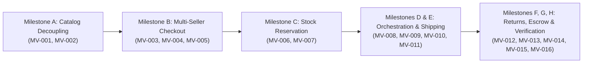

# GLAMGO — PHASE 5 PRE-IMPLEMENTATION REVIEW
# MULTI-VENDOR COMMERCE & FULFILLMENT ENGINE

**Document Version:** 1.0.0 (Canonical Pre-Implementation Review)  
**Date:** November 11, 2026  
**Review Leads:** Principal Software Architect, Application Security Engineer, Database Engineer, Backend Lead, QA Lead  
**Phase Status:** **PLANNING ONLY — PENDING EXPLICIT USER APPROVAL**  
**Working Tree Status:** Clean / Preserved (0 Code Modifications Applied in Phase 5)  

---

## 1. EXECUTIVE SUMMARY

GlamGo has successfully completed and verified Phases 1, 2, 2.1, 3, and 4:
- **Phase 1:** Core Architecture Audit & Verification
- **Phase 2:** Administrator Command Centre (11/11 Stories Passed)
- **Phase 2.1:** Independent Security & Reliability Hardening
- **Phase 3:** Customer Experience & Core Booking Engine (12/12 Stories Passed)
- **Phase 4:** Partner Ecosystem & Business Operations (14/14 Stories Passed)
- **Current Test Status:** 38/38 automated tests passing across `test_admin_phase2.py`, `test_customer_phase3.py`, and `test_partner_phase4.py`.
- **Frontend Build:** Vite v7.3.7 compiles cleanly in 643ms (`npm run build`).

Phase 5 transitions GlamGo from single-seller commerce into a full-fledged **Multi-Vendor Commerce & Fulfillment Engine**. 

Per explicit instructions:
> **Strict Planning-Only Rule:** No application code (`src/` or `backend/app/`), database schemas, migrations, or test passing flags have been modified. This document presents the complete pre-flight evaluation, architectural blueprint, database design, API specification, and test plan for formal review. Implementation will commence only upon explicit user approval.

---

## 2. PHASE 4 BASELINE AUDIT & GAP ANALYSIS

A thorough preflight inspection of the codebase identified the following foundational gaps between Phase 4 and the enterprise multi-vendor target:

| Commerce Dimension | Phase 4 Current Codebase | Phase 5 Target Architecture | Identified Risk / Architectural Gap |
| :--- | :--- | :--- | :--- |
| **Catalog Architecture** | 1 `Product` row represents 1 seller's listing (`backend/app/models/catalog.py`). | Master `Product` decoupled from multiple `SellerListing` offers holding individual price, SKU, and stock. | Multiple sellers cannot offer the same item without polluting search and reviews with duplicate products. |
| **Cart Model** | Client-side key-value `{ [productId]: qty }` (`src/app.js`). | Multi-vendor cart grouping line items by merchant with itemized delivery fees and timelines. | Customers cannot see multi-package delivery expectations or individual seller origins. |
| **Order Orchestration** | Monolithic `Order` with single `status` shared across all items (`backend/app/models/order.py`). | Hierarchical order tree: Parent `Order` split into autonomous child `SubOrder`s per merchant. | In a multi-seller checkout, Seller A updating status to `in_transit` prematurely updates Seller B's items. |
| **Inventory Control** | Direct instant decrement on checkout creation (`product.stock -= qty`). | Two-phase commit: `InventoryReservation` with 15-minute TTL, confirmed only upon Razorpay HMAC verification. | If customer abandons payment at gateway, reserved stock is permanently lost or requires manual reconciliation. |
| **Fulfillment & Logistics** | Generic status flag (`placed` → `packed` → `in_transit` → `delivered`). | Dedicated `Shipment` entity capturing carrier name, tracking ID, and live dispatch/delivery timestamps. | Customers have zero visibility into courier tracking numbers or package transit details. |
| **Returns & Reverse Logistics** | Cancellation exists for bookings only; orders cancelled as a whole. | Granular `ReturnRequest` per suborder/item with 7-day window, photo inspection, and conditional restock. | Inability to return a single damaged item from a multi-item shipment. |
| **Financial Settlement** | Real-time calculation of net earnings without escrow holding. | Escrow ledger holding seller payout until $T+3$ days post-delivery to allow customer dispute window to close. | Premature payout to sellers before customer return requests are filed and settled. |

---

## 3. COMPREHENSIVE PHASE 5 DELIVERABLES SUMMARY

During this planning phase, the following canonical design artifacts were authored:

1. **`docs/implementation/PHASE_5_PRD.md`**  
   - Detailed product requirements covering retail customers, product merchants, logistics coordinators, and platform administrators.
   - 16 atomic stories (`MV-001` through `MV-016`) mapped across Milestones A through H.
   - Comprehensive edge-case handling for out-of-stock races, partial fulfillments, and refund clawbacks.

2. **`docs/implementation/PHASE_5_ARCHITECTURE.md`**  
   - Sequence diagrams for Multi-Seller Checkout, Suborder Fulfillment, and Reverse Logistics.
   - Row-locking reservation architecture (`SELECT ... FOR UPDATE ORDER BY id ASC`) to eliminate overselling and deadlocks.
   - Escrow maturity state machine.

3. **`docs/implementation/PHASE_5_DATABASE_DESIGN.md`**  
   - Complete PostgreSQL 16 DDL for 7 new tables: `seller_listings`, `inventory_reservations`, `suborders`, `shipments`, `return_requests`, `inventory_audit_logs`, `seller_escrow_records`.
   - Non-destructive Alembic migration strategy with zero data loss for existing Phase 1–4 records.
   - Indexing and check constraints for high-throughput concurrency.

4. **`docs/implementation/PHASE_5_API_CHANGES.md`**  
   - REST API contracts for customer catalog offers, 15-minute reservations, multi-vendor split checkout, package tracking, and return submission.
   - Seller portal endpoints for listing management, packing, courier dispatch, return decisions, and escrow financial statements.
   - Background engine tasks for expiring abandoned reservations and maturing escrow payouts.

5. **`docs/implementation/PHASE_5_TEST_PLAN.md`**  
   - Verification matrix for all 16 stories with specific test function specifications in `tests/test_multi_vendor_phase5.py`.
   - Concurrency race condition tests proving zero overselling under simultaneous customer requests.
   - Full regression suite gates across Phase 2, Phase 3, Phase 4, and Vite production bundle.

---

## 4. 16-STORY ROADMAP BREAKDOWN (`MV-001` TO `MV-016`)



### Milestone Breakdown:
- **Milestone A — Multi-Vendor Catalog:**
  - `MV-001` (P0): Master Product & Seller Offer Listings
  - `MV-002` (P1): Catalog Moderation & Duplicate Prevention
- **Milestone B — Multi-Seller Cart & Split Checkout:**
  - `MV-003` (P0): Multi-Seller Unified Cart Grouping & Shipping Fee Engine
  - `MV-004` (P0): Split Checkout & Parent/Suborder Hierarchy Generation
  - `MV-005` (P1): Seller-Aware Coupon Apportionment & Itemized Discounts
- **Milestone C — Inventory Reservation & Concurrency:**
  - `MV-006` (P0): Atomic Stock Reservation Engine & 15-Minute TTL Expiry
  - `MV-007` (P0): Row-Locking Concurrency & Append-Only Stock Audit Trail
- **Milestone D — Order Fulfillment Orchestration:**
  - `MV-008` (P0): Parent Order Status Aggregation & State Machine Rollup
  - `MV-009` (P0): Independent Seller Suborder Fulfillment & RBAC Isolation
- **Milestone E — Logistics, Carrier Tracking & Delivery:**
  - `MV-010` (P1): Shipment Tracking & Courier Metadata Integration
  - `MV-011` (P1): Delivery Confirmation & Timeline Enforcement
- **Milestone F — Reverse Logistics & Returns:**
  - `MV-012` (P0): Customer Return Request Gateway (7-Day Post-Delivery)
  - `MV-013` (P0): Partial Return Restocking & Payment Refund Reconciler
- **Milestone G — Multi-Vendor Financial Settlement & Escrow:**
  - `MV-014` (P0): Suborder Financial Ledger & 15% Platform Commission
  - `MV-015` (P1): Escrow Maturity Engine ($T+3$ Days Post-Delivery)
- **Milestone H — Integration, Concurrency & Regression Verification:**
  - `MV-016` (P0): End-to-End Multi-Vendor Regression Harness & Production Verification

---

## 5. TECHNICAL SAFEGUARDS & RELIABILITY MEASURES

1. **Deadlock-Free Locking:** In multi-item checkouts, seller listings are locked in strict ascending order of listing ID:
   ```sql
   SELECT * FROM seller_listings WHERE id IN (:ids) ORDER BY id ASC FOR UPDATE;
   ```
2. **Idempotent Webhooks:** Razorpay payment webhooks verify payment IDs and signatures before updating suborders and finalizing inventory. Duplicate events return `200 OK` with zero duplicate decrements.
3. **Escrow Safety Margin:** Funds are never credited to a merchant's withdrawable balance until $T+3$ days after delivery, ensuring funds remain available if a customer files a legitimate return.
4. **Data Isolation:** All seller queries enforce `seller_id = current_user.id` at the database level. Direct object reference attempts to other merchants' suborders return `403 Forbidden`.

---

## 6. PRE-IMPLEMENTATION READINESS CHECKLIST

- [x] Phase 1–4 source code intact and verified.
- [x] 38/38 existing regression tests passing.
- [x] Vite frontend bundle builds cleanly in < 1 second.
- [x] Detailed PRD (`docs/implementation/PHASE_5_PRD.md`) published.
- [x] Technical Architecture (`docs/implementation/PHASE_5_ARCHITECTURE.md`) published.
- [x] Database Schema & Migration Specification (`docs/implementation/PHASE_5_DATABASE_DESIGN.md`) published.
- [x] REST API Contracts (`docs/implementation/PHASE_5_API_CHANGES.md`) published.
- [x] Comprehensive Test Plan (`docs/implementation/PHASE_5_TEST_PLAN.md`) published.
- [x] Pre-Implementation Review (`docs/reports/PHASE_5_PRE_IMPLEMENTATION_REVIEW.md`) published.
- [x] Phase 5 stories registered in `.planning/ROADMAP.md` and `prd.json` with `passed: false`.
- [x] Working tree clean of any premature code changes.

---

## 7. RECOMMENDATION & NEXT ACTIONS

The planning phase is 100% complete and fully verified. The architecture and database migration strategies guarantee zero downtime, backward compatibility, and robust protection against race conditions and overselling.

**Awaiting user authorization to proceed with execution of Phase 5 (Milestones A through H).**
