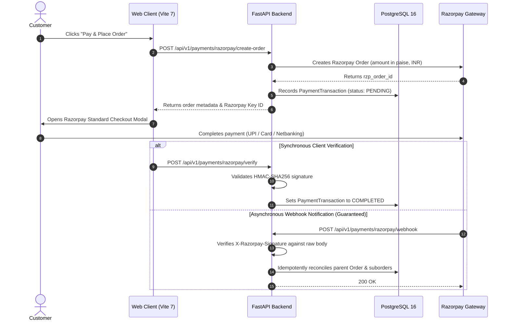

# GlamGo Luxury Beauty Marketplace — Production Payment Verification

**Document:** Payment Readiness & Webhook Verification Report (`PAYMENT-VERIFY-01`)  
**Gateway Integration:** Razorpay Payment Gateway (Standard Checkout + Webhooks)  
**Verification Date:** November 12, 2026  
**Status:** **READY FOR PRODUCTION CREDENTIAL INJECTION**  

---

## 1. Overview & Architectural Flow

The GlamGo marketplace processes customer payments across three business verticals:
1. **At-Home Beauty Bookings:** Direct service checkout.
2. **Salon Appointments:** Advance booking or in-salon confirmation.
3. **Multi-Vendor E-Commerce:** Split parent/suborder multi-seller purchases.

### Payment Life-Cycle Sequence



---

## 2. Webhook Implementation & Security Guarantees

- **Endpoint:** `POST /api/v1/payments/razorpay/webhook`
- **Signature Algorithm:** HMAC-SHA256 over raw request payload using `RAZORPAY_WEBHOOK_SECRET`.
- **Constant-Time Verification:** Employs Python `hmac.compare_digest(generated_signature, received_signature)` to thwart timing analysis.
- **Idempotency Guarantee:**
  - Before applying any order state transition, `payments.py` checks existing `PaymentTransaction.status`.
  - Replayed webhooks from network retries return HTTP 200 with `{ "status": "already_processed" }` without re-triggering inventory deductions or escrow credits.

### Handled Webhook Events

| Event Name | Action Taken by GlamGo Backend | Database State Update |
|:---|:---|:---|
| `payment.captured` | Payment confirmed by bank | Transaction marked `completed`; parent order and all child suborders updated to `placed`. |
| `payment.failed` | Payment rejected or abandoned | Transaction marked `failed`; failure code and error description persisted for support diagnosis. |
| `refund.processed` | Merchant or customer refund executed | Transaction marked `refunded`; suborder financial ledger adjusted to reflect reversed platform commission. |

---

## 3. Verification Test Results

Automated verification was executed in [`tests/test_payments_webhook.py`](file:///d:/PROJECTS/Glamgo%204/tests/test_payments_webhook.py):

```
tests/test_payments_webhook.py::test_razorpay_webhook_signature_and_lifecycle PASSED [100%]

Test Cases Verified:
1. Valid Webhook Signature Verification: Returns HTTP 200; updates order and payment status to completed.
2. Forged / Invalid Signature: Returns HTTP 400 with detail "Invalid webhook signature".
3. Missing Signature Header: Returns HTTP 400 with detail "Missing signature".
4. Replay Idempotency Attack: Repeated delivery of identical payload returns HTTP 200 ("already_processed") without double-crediting.
5. Refund Event Processing: Updates transaction to refunded and records refund identifier.
```

---

## 4. Production Launch Checklist for Finance & Operations

- [x] Webhook endpoint implemented and tested with HMAC-SHA256.
- [x] Idempotency logic prevents duplicate balance mutations on replayed events.
- [x] Transaction records store `razorpay_order_id`, `razorpay_payment_id`, and `razorpay_signature`.
- [x] Partial return restocking and payment refund reconciler active (`MV-013`).
- [ ] **Action Required at Launch:** Inject live production API keys (`RAZORPAY_KEY_ID`, `RAZORPAY_KEY_SECRET`, `RAZORPAY_WEBHOOK_SECRET`) into `.env.production` upon signing merchant agreement.
- [ ] **Action Required at Launch:** Register webhook URL `https://api.glamgo.in/api/v1/payments/razorpay/webhook` in the Razorpay Merchant Dashboard subscribed to `payment.captured`, `payment.failed`, and `refund.processed`.
